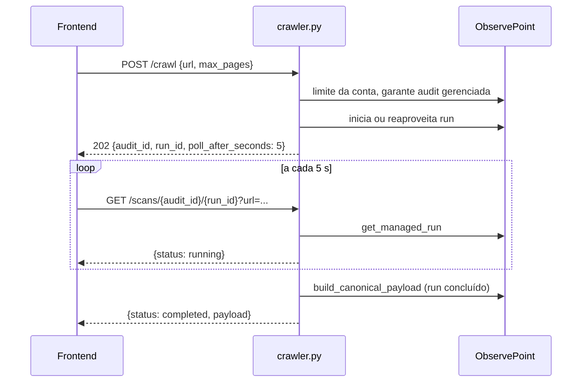

# Router Crawler

Prefixo `/api/crawler`, autenticado. Router: `backend/routers/crawler.py`. Serviços: `backend/services/crawler_service.py` (normalização e início) e `backend/services/observepoint_service.py` (cliente REST). Ver [ObservePoint](../integracoes/observepoint.md).

## Rotas

| Método | Caminho | Entrada | Resposta | Erros |
|---|---|---|---|---|
| GET | `/api/crawler/status` (`:53`) | n/d | `{"status","engine","observepoint":{...}}` | n/d |
| GET | `/api/crawler/observepoint/audits` (`:63`) | query `size` (1-100, padrão 50), `page` (>=0) | `{"audits":[...]}` | 400, 500 |
| GET | `/api/crawler/observepoint/journeys` (`:74`) | idem | `{"journeys":[...]}` | 400, 500 |
| POST | `/api/crawler/crawl` (`:85`, 202) | `CrawlRequest` | `{"status":"queued","audit_id","run_id","poll_after_seconds":5,"reused_running_run","starting_urls"}` | 401/403, 409, 422, 500, 502 |
| GET | `/api/crawler/scans/{audit_id}/{run_id}` (`:100`) | query `url` (obrigatória), `project_id?`, `report_id?` | `{"status","audit_id","run_id","poll_after_seconds"}` + `payload` ou `detail` | 422, 401/403, 409, 500, 502 |

`CrawlRequest` (`:16-39`): `url` **ou** `urls` (exatamente um; ambos ou nenhum dá 422), `max_pages` (>0, padrão 10). Strings em branco são rejeitadas e aparadas.

## Início e polling



`start_website_audit` (`crawler_service.py:33`): exige `OBSERVEPOINT_API_KEY`; com `urls`, o limite de páginas vira `len(urls)`; senão usa `max_pages`. Compara com o limite da conta (`get_account_page_limit`), chama `ensure_managed_audit` e `start_or_reuse_run`. O `reused_running_run` indica que já havia execução em andamento.

`poll_scan` é stateless: normaliza a URL, busca o run, mapeia o status com `normalize_run_status`. Em `failed` devolve `detail`; em `completed` monta o payload canônico para aquele `run_id` e, se vieram `project_id` e `report_id`, grava um run `crawler` (`crawler.py:121-124`).

## Mapa de erros upstream

`_upstream_error` (`crawler.py:41-51`):

| Upstream | Resposta |
|---|---|
| 401/403 | mesmo status, "Sem permissão para configurar ou executar auditorias no ObservePoint." |
| 422 | 422, URL ou configuração rejeitada |
| 409/429 com `quota`/`limit`/`capacity` na mensagem | 409, cota atingida |
| outros | 502 `Falha na API do ObservePoint: ...` |

`ValueError` (URL inválida, limite excedido, chave ausente) vira 422. Qualquer outra exceção, 500.

## Exemplo

```bash
curl -X POST http://localhost:8000/api/crawler/crawl \
  -H "Authorization: Bearer <id_token>" -H "Content-Type: application/json" \
  -d '{"url":"https://www.exemplo.com","max_pages":10}'
# 202 {"status":"queued","audit_id":123,"run_id":456,"poll_after_seconds":5,
#      "reused_running_run":false,"starting_urls":["https://www.exemplo.com/"]}

curl -H "Authorization: Bearer <id_token>" \
  "http://localhost:8000/api/crawler/scans/123/456?url=https://www.exemplo.com&project_id=<project_id>&report_id=<report_id>"
```

## Pontos de atenção

- `/status`, `/observepoint/*` e `/crawl` não declaram o `user`, só dependem do `Depends` do router; apenas `/scans` usa o e-mail (para `save_run_safe`).
- `normalize_url` rejeita esquemas não HTTP(S) e credenciais na URL (`crawler_service.py:12-14`).
- Chave ausente: `/observepoint/*` devolve 400, mas `/crawl` devolve 422 (vem como `ValueError`).
- Cada novo polling `completed` grava outro run se o front continuar chamando; pare o loop ao receber `completed`.
- `size`/`page` têm teto 100 na query; erros genéricos nas listagens viram 500, não 502.
