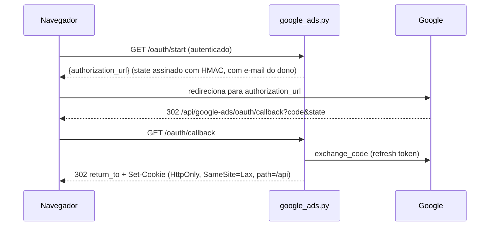

# Router Google Ads

Prefixo `/api/google-ads`. Router: `backend/routers/google_ads.py`, com dois `APIRouter`: `router` (autenticado) e `oauth_callback_router` (público, `:171`, registrado em `main.py:40`). Serviços: `google_ads_oauth_service.py` (OAuth e cookie), `google_ads_api_service.py` (API ao vivo), `google_ads_service.py` (CSV). Ver [Google OAuth](../integracoes/google-oauth.md) e [Google Ads](../integracoes/google-ads.md).

## Rotas

| Método | Caminho | Auth | Entrada | Resposta | Erros |
|---|---|---|---|---|---|
| GET | `/oauth/start` (`:48`) | sim | query `return_to` (só caminho relativo; padrão `/?google_ads=connected`) | `{"authorization_url"}` | 503 |
| GET | `/oauth/callback` (`:59`) | não | query `state`, `code?`, `error?` | redirect 302 + cookie | nunca erro HTTP (redireciona) |
| GET | `/connection` (`:88`) | sim | cookie `gtm_google_ads_session`* | `{"configured","missing_settings","connected"}` | n/d |
| DELETE | `/connection` (`:103`) | sim | cookie | `{"connected":false,"revoked"}` | n/d |
| GET | `/accounts` (`:119`) | sim + cookie | n/d | contas acessíveis | 401, Google (`status_code`) |
| POST | `/analyze-live` (`:131`) | sim + cookie | `LiveAnalysisBody` | resultado canônico | 401, 422, Google |
| POST | `/analyze` (`:162`) | sim | multipart CSVs | ações de conversão | 400 |

\* O cookie é `gtm_google_ads_session` (`GOOGLE_ADS_COOKIE`, `google_ads_oauth_service.py:24`); a sessão compartilha o cookie com GTM e GA4.

`LiveAnalysisBody` (`:30-36`): `customer_id`, `login_customer_id?`, `start_date?`, `end_date?`, `project_id?`, `report_id?`. `/analyze`: `conversion_actions` (obrigatório), `custom_goals_config?`, `goal_config?`, `customer_id?`.

## OAuth



O `state` é assinado com HMAC-SHA256 e `return_to` externo é trocado pelo padrão. Criação em `create_state` (`google_ads_oauth_service.py:78`) e validado/expirado em `read_state` (`:91`). O cookie guarda a conexão cifrada (Fernet, `:65`) e `read_connection` (`:176`) confere que o cookie pertence ao e-mail do usuário atual. O callback é público porque o navegador chega do Google sem header de auth; quem garante a identidade é o `state`.

## Análise ao vivo

`analyze_google_ads_live` (`google_ads.py:131-159`) roda `analyze_live_account` em threadpool. Com `project_id` e `report_id`, grava um run `live` e, se salvou, registra os ids em `google_accounts` do projeto (`record_google_accounts`) e chama `save_google_ads_analysis_safe`. Período: dias completos, em ordem, máximo 366 dias (`ValueError` → 422). MCCs são expandidas para contas-cliente.

`GoogleAdsApiError` carrega `status_code` e `request_id`; o router devolve `detail={"message","request_id"}`.

## Exemplo

```bash
curl -b "<cookie_da_sessao>" -X POST http://localhost:8000/api/google-ads/analyze-live \
  -H "Authorization: Bearer <id_token>" -H "Content-Type: application/json" \
  -d '{"customer_id":"1234567890","start_date":"2026-01-01","end_date":"2026-01-31"}'
```

```bash
curl -X POST http://localhost:8000/api/google-ads/analyze \
  -H "Authorization: Bearer <id_token>" \
  -F "conversion_actions=@acoes.csv" -F "customer_id=1234567890"
```

## Pontos de atenção

- Sem cookie ou com cookie de outro usuário: 401 (`_connection`, `:41-45`). A conexão "precisa ser renovada" se faltam escopos de GTM/GA4.
- O callback nunca devolve JSON de erro: sempre redireciona para `/?google_ads=error&message=...`.
- `Secure` no cookie só em `prod`/`production` (`:79-85`); em dev ele trafega sem HTTPS.
- `DELETE /connection` limpa o cookie nos paths `/api` e `/api/google-ads` (legado) e informa `revoked` conforme a revogação no Google.
- `/analyze` captura qualquer exceção como 400, inclusive CSV acima de 10 MB e colunas ausentes (`google_ads_service.py:42,237`).
- Cache de contas acessíveis por refresh token em memória (`google_ads_api_service.py:60-73`).
