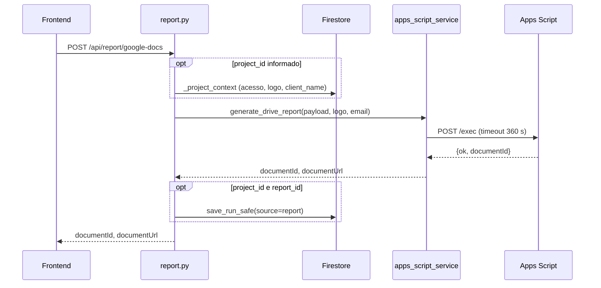

# Router Report

Prefixo `/api/report`, autenticado. Router: `backend/routers/report.py`. Serviços: `backend/services/apps_script_service.py` (`generate_drive_report`) e `backend/services/drive_service.py` (conta publicadora). Fluxo completo em [Fluxo de geração](../geracao-do-documento/fluxo-de-geracao.md) e [Apps Script](../integracoes/apps-script.md).

## Rotas

| Método | Caminho | Entrada | Resposta | Erros |
|---|---|---|---|---|
| POST | `/api/report/google-docs` (`report.py:31`) | `{"payload": {...}, "project_id?", "report_id?"}` | `{"documentId","documentUrl"}` | 404, 422, 502, 503, 504 |
| GET | `/api/report/publisher-status` (`report.py:50`) | n/d | `{"configured": bool, "healthy": bool}` | n/d |

## Fluxo de `google-docs`



1. Com `project_id`, `_project_context` (`report.py:21-28`) exige acesso (404 caso contrário), pega o `logo_base64` do projeto e, se o payload não tem `client_name`, usa o do projeto.
2. `generate_drive_report` (`apps_script_service.py:18`) valida config, coleções e logo, calcula mês/ano a partir de `snapshot_date`, obtém token da conta publicadora e faz `POST` ao Web App com `{secret, payload, client_logo_base64}`.
3. Com `project_id` e `report_id`, grava um run `report` com os ids do documento; `save_run` muda o relatório para `status: "generated"`.

## Erros do Apps Script

| Status | Causa | Linha |
|---|---|---|
| 503 | Variáveis ausentes ou URL que não é `/exec` | `apps_script_service.py:24,26` |
| 422 | Coleção inválida ou logo inválido (PNG/JPEG/GIF, até 5 MB) | `:31,45` |
| 502 | Falha ao renovar token, HTTP 4xx/5xx do Web App, falha de transporte, resposta não JSON, `ok != true`, `documentId` inválido | `:58-88` |
| 504 | Timeout (360 s) | `:66` |

## Exemplo

```bash
curl -X POST http://localhost:8000/api/report/google-docs \
  -H "Authorization: Bearer <id_token>" -H "Content-Type: application/json" \
  -d '{"payload":{"client_name":"Cliente Exemplo","snapshot_date":"2026-01-15T00:00:00Z"},
       "project_id":"<project_id>","report_id":"<report_id>"}'
# {"documentId":"<doc_id>","documentUrl":"https://docs.google.com/document/d/<doc_id>/edit"}
```

## Pontos de atenção

- Em 504 o documento **pode ter sido criado**: confira a pasta no Drive antes de gerar de novo (mensagem do próprio backend). Ver [Timeout e erros](../geracao-do-documento/timeout-e-erros.md).
- O payload enviado ao Apps Script é o enriquecido (`document_owner_email`, `document_month`, `document_year`), mas o run salvo guarda o `payload` do request (com `client_name` preenchido, sem os campos de documento).
- `publisher-status` só chama `check_publisher_health` se `is_publisher_configured()`; reflete a conta publicadora, não a conexão Google do usuário.
- Se `save_run_safe` falhar, o documento já existe e a resposta ainda é 200.
