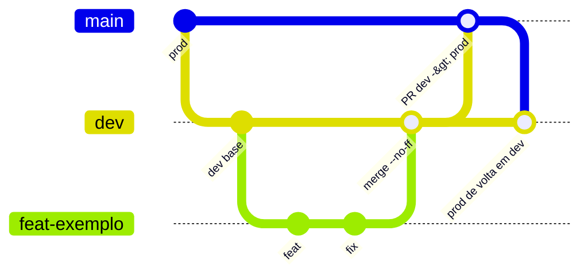

# Git e commits

Regras vindas de `AGENTS.md`, `CLAUDE.md` e do README do app ("Fluxo Git para desenvolvimento solo"), conferidas contra `git log`. Valem para trabalho **novo**; o histórico existente é preservado.

## Modelo de branches

- `dev`: integração e base de toda tarefa (branch padrão no GitHub, `origin/HEAD -> origin/dev`).
- `prod`: código aprovado para produção.
- Nunca desenvolver direto em `dev` ou `prod`.
- Uma branch de tarefa por vez: `feat/`, `fix/`, `hotfix/`, `refactor/`, `docs/` ou `chore/` + descrição curta em inglês, minúscula, kebab-case. Sem prefixo de IA/ferramenta. `chore/` também para testes ou CI isolados. Sem branches de release.

(No diagrama, `main` representa `prod`.)

## Passo a passo

1. Conferir branch e working tree; preservar mudanças e stashes pendentes.
2. `git switch dev && git pull --ff-only`, depois criar a branch de tarefa.
3. Para atualizar a branch de tarefa, fazer **merge** de `dev` nela.
4. Antes de integrar: revisar o diff e rodar testes de backend, testes de frontend e `npm run build` ([Testes](./testes.md)).
5. Integrar em `dev` localmente com `git merge --no-ff`.
6. Promover `dev` para `prod` por PR com "Create a merge commit". O dev solo revisa e conclui; não exige segundo revisor. Depois, merge de `prod` atualizado em `dev`.
7. Apagar a branch de tarefa só após integração confirmada.

**Hotfix:** `hotfix/*` parte de `prod` atualizado, entra em `prod` por PR e volta a `dev` por merge de `prod`.

**Proibido:** rebase, squash, force-push, reset para reescrever histórico. Divergência se resolve com merge. Pull só com `--ff-only`.

**Branches legadas** (`master`, `Database_integration`, `app-scripts-integration`, `new_template_and_application_changes`): não retomar nem mesclar o que for exclusivo delas sem revisão.

## Conventional Commits

Formato: `<type>(<scope opcional>): <descrição no imperativo, em inglês>`, inclusive em merges feitos por humanos.

Contagem em 73 commits do histórico atual (`git log` a partir do HEAD):

| Tipo | Qtd |
|---|---|
| `fix` | 26 |
| `feat` | 25 |
| `refactor` | 10 |
| `docs` | 2 |
| `chore` | 2 |
| `build` | 1 |
| fora do padrão | 7 |

Escopos reais em uso: `appscript` (5, mais variantes `appscripts` e `apps-script`), `frontend` (5), `google-ads` (4), `deploy` (3), `report` (3), `transcripts`, `gtm-audit`, `ga4`, `crawler`, `auth`, `audit` (2 cada), além de `projects`, `persistence`, `observepoint`, `oauth`, `makefile`, `git`, `services`, `router`, `considerations`, `cleanup` e outros de uso único. Não há lista fechada; prefira um escopo já existente e escreva-o de forma consistente (`google-ads`, não `GAds`).

### Bons exemplos do histórico

- `feat(projects): split client/project name and auto-record Google accounts`
- `fix(appscript): omit empty tables, forms list and considerations`
- `refactor(appscript): restructure EC and offline sections with subsections`

### Maus exemplos (existem no histórico; não repetir)

| Commit | Problema |
|---|---|
| `Create CLAUDE.md`, `Create AGENTS.md` | sem tipo (mensagem padrão do GitHub) |
| `CI(prod): changes to ...` | tipo em maiúsculas e inexistente no vocabulário |
| `BREAKING CHANGE: replace /api/report/docx ...` | sem tipo/escopo; o rodapé `BREAKING CHANGE:` deveria acompanhar um `feat!`/`refactor!` |
| `fix(appscripts) : adding the footer` | espaço antes dos dois pontos e verbo em gerúndio |
| `fix(GAds): ...` | escopo fora do padrão kebab-case |
| `First Commit` | sem tipo |

## Prática x regra

- Só há **um** commit de merge real no histórico: `375c312 Merge branch 'feat/apps-script-reports' into dev ...` (e ele também não segue o formato). A maior parte do histórico é linear, anterior à adoção do fluxo.
- `prod` está atrás de `dev`: `dev` tem 14 commits que `prod` não tem e `prod` não tem nenhum commit exclusivo.
- Há branches antigas ainda presentes (`refator/documentation-and-ai-use`, com erro de digitação no prefixo, além das legadas listadas acima).
- 7 de 73 mensagens não seguem Conventional Commits.

## Pull requests

Explicar mudanças e verificação, linkar issue quando houver, anexar screenshots em mudanças visíveis de UI e destacar mudanças em API, payload, template ou variáveis de ambiente.

## Regras para IA

- A IA **não faz commit** (nem merge). Ela informa arquivos alterados, verificações executadas e **sugere** uma mensagem Conventional Commit.
- A IA nunca faz deploy ou push para produção ([Deploy](./deploy.md)).
- Inspecionar branch e working tree antes de editar; não descartar nem misturar mudanças pendentes. Mais em [AGENTS.md e CLAUDE.md](../ia-e-agentes/agents-md.md).
