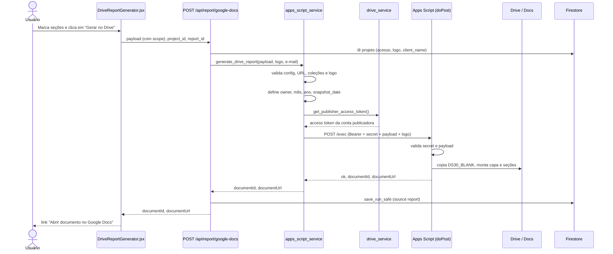

# Fluxo de geração

O diagnóstico final é um Google Doc criado por um Web App do Apps Script. O backend FastAPI só valida, complementa o payload e repassa a chamada.

## Visão em sequência



## Etapas

1. **Frontend.** `DriveReportGenerator` (`frontend/src/components/DriveReportGenerator.jsx`) mostra as decisões pendentes e os checkboxes de seção (`SECTION_TOGGLES`). Cada checkbox chama `withSectionToggle`, que grava `payload.scope` (ver [Payload v3](./payload-v3.md)). O botão chama `generateDriveReport` em `frontend/src/services/api.js:121`, que envia `{payload, project_id, report_id}` com os cabeçalhos de autenticação.
2. **Rota.** `generate_google_doc` em `backend/routers/report.py:31` exige usuário autenticado. Com `project_id`, carrega o projeto (404 se não existe ou sem acesso, `backend/routers/report.py:21`), usa o `logo_base64` do projeto e preenche `client_name` se o payload não trouxer um. O logo não vem do request.
3. **Serviço.** `generate_drive_report` (`backend/services/apps_script_service.py:18`) executa as verificações abaixo.
4. **Apps Script.** `doPost` (`Docs/ds30_appscript/Main.js:70`) confere o segredo e chama `generateDs30`. Detalhes em [Apps Script por dentro](./apps-script-por-dentro.md).
5. **Persistência.** Se vieram `project_id` e `report_id`, `save_run_safe` grava a execução (`source='report'`) com o payload original, o e-mail e o documento (`backend/routers/report.py:42`). É best-effort: falha de Firestore não derruba a resposta (`backend/services/firestore_service.py:116`).

## Ordem das verificações no serviço

| # | Verificação | Linha | Falha |
|---|---|---|---|
| 1 | `DS30_APPS_SCRIPT_URL`, `DS30_APPS_SCRIPT_SECRET` e credenciais da conta publicadora presentes | `apps_script_service.py:21` | 503 |
| 2 | URL casa com o padrão `https://script.google.com/.../exec` | `apps_script_service.py:25` | 503 |
| 3 | Coleções são listas de objetos (`gtm_containers`, `gtm_variables`, `gtm_tags`, `platform_accounts`, `conversion_actions`, `matching_signals`, `upd_form_urls`, `changelog_entries`, `analyzed_urls`, `cdns`) | `apps_script_service.py:27` | 422 |
| 4 | Logo: PNG/JPEG/GIF, até 5 MB, base64 válido, formato real confere com o MIME | `apps_script_service.py:32` | 422 |
| 5 | Campos definidos pelo servidor: `document_owner_email` (da sessão), `document_month` (em pt-BR), `document_year`, `snapshot_date` normalizado (usa agora se inválido) | `apps_script_service.py:46` | n/a |
| 6 | Token da conta publicadora (`get_publisher_access_token`) | `apps_script_service.py:55` | 502 |
| 7 | POST com `httpx`, timeout de 360 s (10 s de conexão), segue redirecionamentos | `apps_script_service.py:59` | 502/504 |
| 8 | Resposta JSON com `ok: true` e `documentId` válido | `apps_script_service.py:82` | 502 |

As verificações 1 a 6 acontecem antes de qualquer chamada ao Apps Script. Os códigos e o que fazer em cada um estão em [Timeout e erros](./timeout-e-erros.md).

## Resposta

```json
{"documentId": "...", "documentUrl": "https://docs.google.com/document/d/<id>/edit"}
```

A URL é montada pelo backend a partir do `documentId`, não repassada do script (`apps_script_service.py:89`).

## Saúde da conta publicadora

`GET /api/report/publisher-status` (`backend/routers/report.py:50`) retorna `{configured, healthy}`: tenta renovar o token da conta publicadora, sem tocar no Apps Script.

Ver também: [Integração com Apps Script](../integracoes/apps-script.md), [API de relatório](../api/report.md), [Variáveis de ambiente](../referencia/variaveis-de-ambiente.md).
