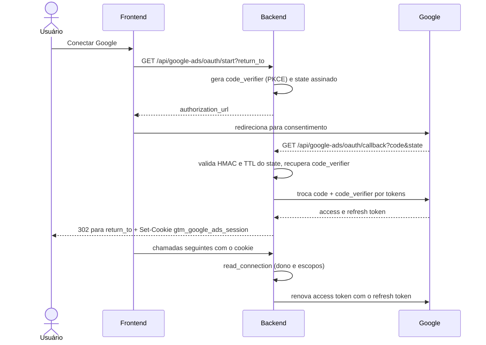

# Google OAuth (Ads, GTM e GA4)

Uma única conexão por usuário atende Google Ads, GTM e GA4. A implementação está em `backend/services/google_ads_oauth_service.py` e as rotas em `backend/routers/google_ads.py`. O nome "Google Ads" ficou no código por motivo histórico. Esta conexão é diferente da conta publicadora que gera o documento (ver [Apps Script](./apps-script.md)).

## Escopos

| Escopo | Uso |
|---|---|
| `https://www.googleapis.com/auth/adwords` | Google Ads |
| `https://www.googleapis.com/auth/tagmanager.readonly` | GTM |
| `https://www.googleapis.com/auth/analytics.readonly` | GA4 |

Constantes em `google_ads_oauth_service.py:20` a `:23`. O fluxo pede `access_type=offline` e `prompt=consent` para sempre obter refresh token (`:130`).

## Variáveis de ambiente (apenas nomes)

`GOOGLE_CLIENT_ID`, `GOOGLE_CLIENT_SECRET`, `GOOGLE_ADS_OAUTH_REDIRECT_URI`, `GOOGLE_ADS_SESSION_ENCRYPTION_KEY` para o OAuth (`:27`); Google Ads exige também `GOOGLE_ADS_DEVELOPER_TOKEN` (`:33`). `GET /api/google-ads/connection` informa `configured` e `missing_settings` (só nomes). Ver [Variáveis de ambiente](../referencia/variaveis-de-ambiente.md).

## Fluxo

## Peças de segurança

- **PKCE.** `build_authorization_url` gera um `code_verifier` aleatório (`:125`); ele viaja dentro do `state`, criptografado com Fernet (`:85`), e é recuperado em `exchange_code` (`:141`).
- **State assinado.** `create_state` (`:78`) serializa `owner` (e-mail em minúsculas), `return_to`, `issued_at` e o verifier, assinando com HMAC-SHA256 usando `GOOGLE_ADS_SESSION_ENCRYPTION_KEY`. `read_state` (`:91`) compara a assinatura em tempo constante e rejeita estado com mais de `STATE_TTL_SECONDS = 600` s (ou mais de 30 s no futuro).
- **`return_to`.** Só é aceito se começar com `/` e não com `//` (caminho relativo ao próprio site); senão cai em `/?google_ads=connected` (`:81`).
- **Cookie `gtm_google_ads_session`.** O refresh token **só existe neste cookie**: o conteúdo (`refresh_token`, `owner`, `scopes`, `issued_at`) é criptografado com Fernet, cuja chave é derivada por SHA-256 da chave de sessão (`:65`, `:167`). Não há cópia no Firestore. Atributos: `httponly`, `samesite=lax`, `path=/api`, `secure` apenas quando `ENVIRONMENT` é `prod`/`production` (`backend/routers/google_ads.py:77`). O callback apaga o cookie antigo com `path=/api/google-ads` para não sombrear o novo.
- **`read_connection`** (`:176`) descriptografa o cookie e exige que `owner` seja o e-mail da sessão autenticada e que os três escopos estejam presentes. Cookie de outro usuário ou conexão antiga só com Ads retorna erro (a rota converte em 401, `backend/routers/google_ads.py:41`), pedindo reconexão.
- **Revogação.** `DELETE /api/google-ads/connection` chama `revoke_connection` (`:203`), que envia o refresh token ao endpoint de revogação do Google (200 ou 400 contam como revogado) e sempre remove o cookie.

## Erros comuns do callback

O callback nunca devolve JSON: redireciona para `/?google_ads=error&message=...` (`backend/routers/google_ads.py:59`). Mensagens tratadas: código expirado ou reutilizado (`invalid_grant`), `redirect_uri_mismatch`, recusa do Google, falha de rede e ausência de refresh token (revogar o acesso anterior e reconectar). A URI de redirecionamento cadastrada no cliente OAuth precisa ser idêntica a `GOOGLE_ADS_OAUTH_REDIRECT_URI`; ver [Firebase e GCP](./firebase.md) para o passo a passo no console.

Relacionados: [Autenticação](../visao-geral-e-arquitetura/autenticacao.md), [API Google Ads](../api/google-ads.md), [API plataformas Google](../api/google-platforms.md).
