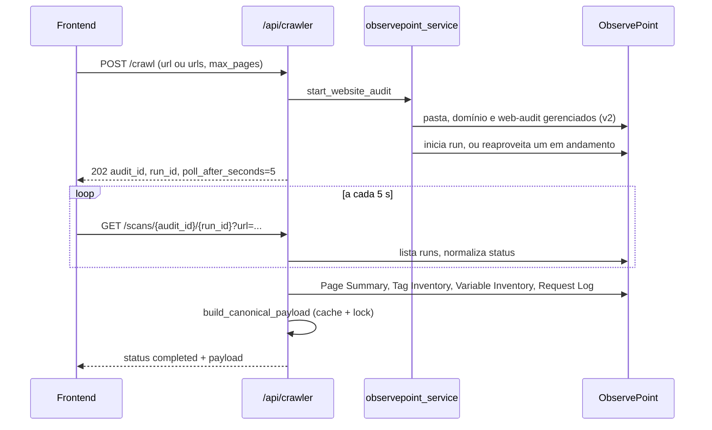

# ObservePoint

O crawler usa a API do ObservePoint para auditar páginas do cliente e transformar os relatórios do run em parte do [payload v3](../geracao-do-documento/payload-v3.md). Arquivos: `backend/services/crawler_service.py` (entrada), `backend/services/observepoint_service.py` (API e payload), `backend/services/cdn_analyzer.py` e `backend/services/gtm_request_analyzer.py` (análises). Rotas em `backend/routers/crawler.py` (ver [API crawler](../api/crawler.md)); todas exigem usuário autenticado (`backend/main.py:46`). Configuração: variáveis `OBSERVEPOINT_API_KEY` (cabeçalho `Authorization: api_key ...`, `observepoint_service.py:13`) e `OBSERVEPOINT_BASE_URL`.

## Fluxo

## Início: `start_website_audit`

`crawler_service.py:33`:

1. Exige `OBSERVEPOINT_API_KEY`.
2. Normaliza URLs (`normalize_url`, `:5`): HTTP/HTTPS obrigatório, sem credenciais, sem fragmento. Com lista exata de URLs, o limite de páginas é a quantidade; com uma URL, vale `max_pages` (padrão 10).
3. Consulta o limite da conta (`get_account_page_limit`, `observepoint_service.py:152`) e rejeita se exceder.
4. `ensure_managed_audit` e `start_or_reuse_run`.

## Auditoria gerenciada

`ensure_managed_audit` (`observepoint_service.py:166`) só mexe em recursos do próprio app:

- Usa (ou cria) a pasta `GTM Analyzer App` (`MANAGED_FOLDER_NAME`), o domínio com o hostname dentro dela e o primeiro web-audit desse domínio. Se não existe, cria com `frequency: once`, filtro que inclui só o hostname, Chrome/Linux, localização `brazil` e `fireTags: true`.
- Se as URLs iniciais ou o limite mudaram, atualiza o audit com `PUT` (que exige o objeto completo). Se já há run na fila ou rodando **com outra configuração**, falha com mensagem pedindo para aguardar.

`start_or_reuse_run` (`:270`) devolve o run em andamento (`reused_running_run: true`) ou cria um novo.

## Polling e status

`GET /scans/{audit_id}/{run_id}` (`backend/routers/crawler.py:101`) não guarda estado: busca o run e normaliza com `normalize_run_status` (`observepoint_service.py:260`):

| Status normalizado | Quando |
|---|---|
| `completed` | `complete`, `completed`, `finished`, `success`, `succeeded`, ou `completedAt`/`completed` presente |
| `failed` | `failed`, `failure`, `error`, `cancelled`, `canceled`, `aborted` |
| `running` | `running`, `in_progress`, `processing`, `started`, ou `started` presente |
| `queued` | qualquer outro valor (padrão) |

Em `completed`, a rota monta o payload; com `project_id` e `report_id` grava a execução (`source="crawler"`). Em `failed`, devolve `detail`.

## Payload canônico

`build_canonical_payload` (`:492`) com `_build_canonical_payload_uncached` (`:541`):

- **Cache e lock.** Com `run_id`, o resultado fica em `_payload_cache` (chave: tipo, id, run, URL alvo), protegido por `asyncio.Lock`. Polls concorrentes do mesmo run compartilham uma única `asyncio.Task` (`_payload_tasks`); se a task falha, ela é removida e a próxima chamada tenta de novo. O cache é por instância e sem expiração, em memória.
- **Relatórios lidos** (todos `v3`, timeout 20 s): Page Summary (páginas), Tag Inventory, Variable Inventory (com contas) e o Request Log por página (`fetch_page_requests`). Falha no request log de uma página não derruba o payload: marca verificação falha e o CDN pode sair `inconclusive`.
- **Campos preenchidos:** `analyzed_urls` (com `url_type` inferido de `cart/carrinho`, `checkout`, `login`), `client_url`, `client_server` e `client_reverse_proxy` (cabeçalhos `Server`/`Via`), `client_tag_manager` e `client_cookie_manager` (detecção por nome/ID), `platform_accounts` GA4 por regex (contas Google Ads são filtradas), `upd_variables_identified` (variáveis com nomes como email/phone/user_data), `upd_form_urls` (páginas de checkout e login), `cdns`, `cdn_analysis_status`, `gtm_observations`, `gtg_implemented`, `server_side_gtm_used`, além de aliases escalares e `derive_decision_fields` (`:906`).
- **Não alimenta** `gtm_containers`, `gtm_variables` e `gtm_tags`: esses dados ficam com as integrações oficiais ([GTM e GA4](./google-tag-manager-e-ga4.md)), ver `Docs/observepoint_field_overlap.md`.

## `cdn_analyzer.py`

`analyze_cdns` agrupa evidências por provedor, com o nome da página de origem:

| Método | Evidência |
|---|---|
| `http_headers` | Cabeçalhos da página (`detect_cdn_from_headers`, por exemplo `cf-ray`, `x-amz-cf-id`, `x-akamai-transformed`) |
| `dns_cname` | Cadeia CNAME (até 5 saltos, timeout 3 s) do host da página e de hosts first-party do request log, casada com sufixos conhecidos |
| `ip_asn` | ASN do IP do servidor (consulta DNS ao Team Cymru), para Azion, Cloudflare, Akamai e Fastly |

Confiança: `confirmed` (há cabeçalho), `infrastructure_detected` (ASN) e `dns_only`. Status geral: a menor confiança entre os CDNs, `no_cdn` se nada foi achado e `inconclusive` se houve erro de verificação. A resolução de DNS roda com no máximo 5 hosts em paralelo.

## `gtm_request_analyzer.py`

`analyze_gtm_requests` examina as URLs do request log: `gtm.js` com `GTM-` indica container (web se o host é `googletagmanager.com`, server caso contrário, com endpoint); `gtag/js` com `G-`/`AW-`/`GT-` indica Google tag, e host fora do Google indica Tag Gateway (`gtg_implemented`). Devolve `gtm_observations` com `deployment` (`web`, `server`, `client-side`, `gateway`). Sem requests, `gtg_implemented` e `server_side_gtm_used` ficam `None`.

## Sobre os documentos de apoio

- `Docs/doc_observepoint.md` é uma cópia da referência da API v2 do ObservePoint (campos de pastas, domínios, audits), não descreve o código do app.
- `Docs/observepoint_field_overlap.md` descreve a decisão de não deixar o ObservePoint sobrescrever GTM e Ads. Conferido: o código atual confere (`observepoint_service.py:857` em diante). A parte de GA4 continua vindo do ObservePoint, como o próprio documento admite.

Testes: `backend/tests/test_observepoint_service.py`, `test_crawler_service.py`, `test_cdn_analyzer.py`, `test_gtm_request_analyzer.py`.
