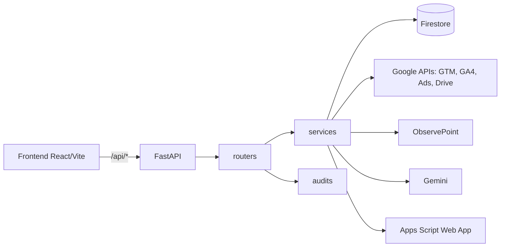
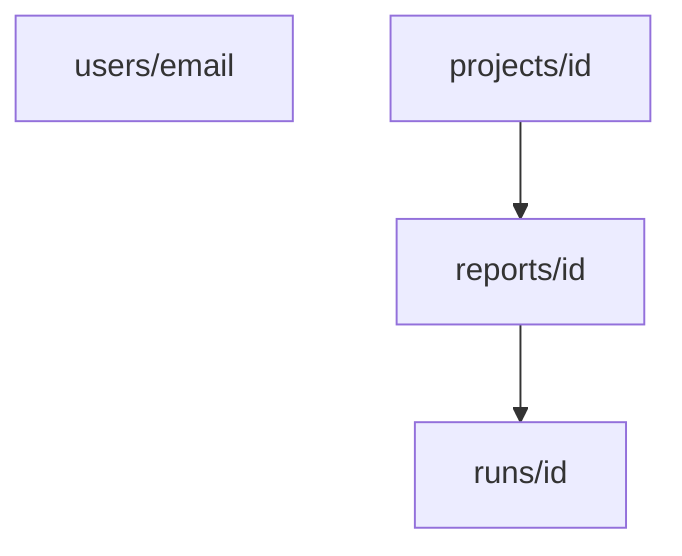

# Arquitetura

## Componentes

- Todos os routers, exceto `auth` e o callback OAuth do Google Ads, são montados com `Depends(get_current_user)` (`backend/main.py:39-49`).
- O CORS usa `ALLOWED_ORIGINS` (`backend/main.py:31`).
- `GET /health` e `GET /api/health` respondem `{"status": "ok"}` (`backend/main.py:51-54`).
- Em desenvolvimento, o Vite (porta 5173) faz proxy de `/api` para `localhost:8000` (`frontend/vite.config.js`).

## SPA servida pelo backend

O `Dockerfile` tem dois estágios: `node:20-alpine` roda `npm run build` e `python:3.11-slim` copia o resultado para `backend/static`. Se `backend/static` existe, `main.py` monta `/assets` e uma rota catch-all devolve o arquivo pedido ou `index.html` (`backend/main.py:57-68`). Sem a pasta, `/` devolve apenas um JSON de status. A imagem também copia o template `.docx` e o mapeamento de variáveis de `Docs/`. O processo escuta em `$PORT` (padrão 8080).

## Modelo no Firestore

Banco `gtm-analyzer`, acessado só pelo backend com credenciais padrão (ADC). Detalhes campo a campo no [Dicionário de dados](../referencia/dicionario-de-dados.md).

- `users/{email}`: espelho do perfil de login.
- `projects/{id}`: coleção de topo (projetos compartilháveis); `owner_email` e `member_emails` controlam acesso.
- `projects/{id}/reports/{id}` e `.../runs/{id}`: relatórios e histórico imutável de execuções.

## Fluxo de uma ação típica: gerar o diagnóstico

1. O frontend chama `POST /api/report/google-docs` com `payload`, `project_id` e `report_id`; `api.js` anexa os cabeçalhos de autenticação.
2. `get_current_user` valida o usuário (ver [Autenticação](./autenticacao.md)).
3. O router verifica acesso ao projeto (404 se não tiver), lê o logo e completa `client_name` (`backend/routers/report.py:31-45`).
4. `generate_drive_report` valida `DS30_APPS_SCRIPT_URL` e o segredo e chama o Apps Script (timeout de 360 s) (`backend/services/apps_script_service.py`).
5. `save_run_safe` grava uma `run` com `source="report"` e marca o relatório como `generated`.
6. A resposta devolve `documentId` e `documentUrl`.

Detalhes em [Fluxo de geração](../geracao-do-documento/fluxo-de-geracao.md).

## Caches e estados por instância

Alguns estados vivem na memória do processo e **não são compartilhados** entre instâncias do Cloud Run nem sobrevivem a restart:

- OTP, sessões de e-mail e rate limit (`backend/services/auth_service.py:16-27`).
- Cache de contas do Google Ads, TTL de 300 s (`backend/services/google_ads_api_service.py:57-73`).
- Cache de payload canônico do ObservePoint (`backend/services/observepoint_service.py:33`).

Com mais de uma instância, um login por OTP pode falhar se a verificação cair em outra instância. Persistir no Firestore é a evolução natural, se necessário.
