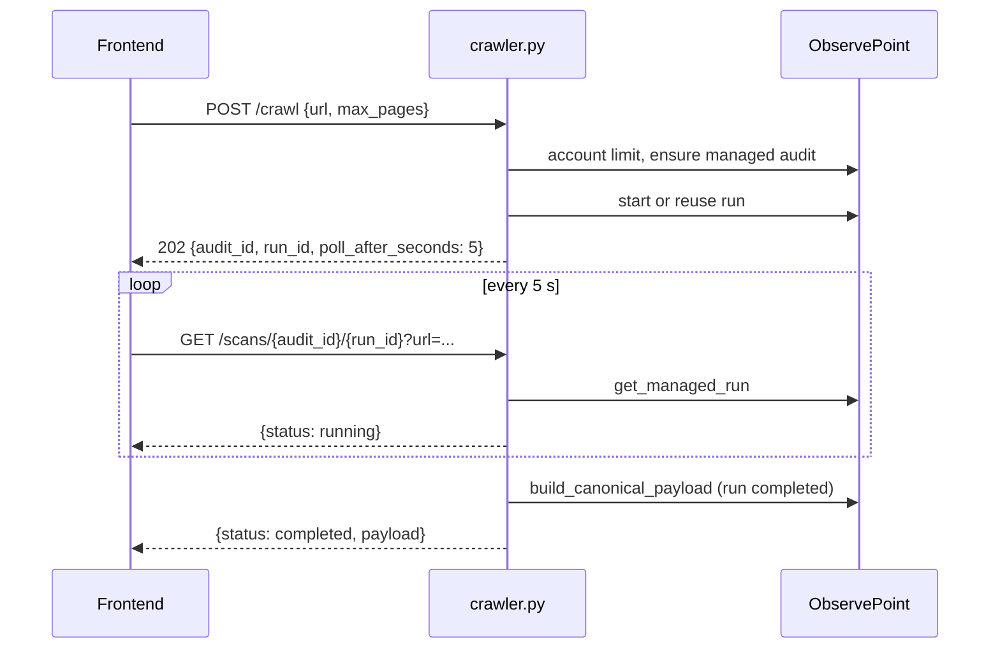

# Crawler router

Prefix `/api/crawler`, authenticated. Router: `backend/routers/crawler.py`. Services: `backend/services/crawler_service.py` (normalization and start) and `backend/services/observepoint_service.py` (REST client). See [ObservePoint](../integracoes/observepoint.md).

## Routes

| Method | Path | Input | Response | Errors |
|---|---|---|---|---|
| GET | `/api/crawler/status` (`:53`) | n/a | `{"status","engine","observepoint":{...}}` | n/a |
| GET | `/api/crawler/observepoint/audits` (`:63`) | query `size` (1-100, default 50), `page` (>=0) | `{"audits":[...]}` | 400, 500 |
| GET | `/api/crawler/observepoint/journeys` (`:74`) | same | `{"journeys":[...]}` | 400, 500 |
| POST | `/api/crawler/crawl` (`:85`, 202) | `CrawlRequest` | `{"status":"queued","audit_id","run_id","poll_after_seconds":5,"reused_running_run","starting_urls"}` | 401/403, 409, 422, 500, 502 |
| GET | `/api/crawler/scans/{audit_id}/{run_id}` (`:100`) | query `url` (required), `project_id?`, `report_id?` | `{"status","audit_id","run_id","poll_after_seconds"}` + `payload` or `detail` | 422, 401/403, 409, 500, 502 |

`CrawlRequest` (`:16-39`): `url` **or** `urls` (exactly one; both or neither gives 422), `max_pages` (>0, default 10). Blank strings are rejected and trimmed.

## Start and polling



`start_website_audit` (`crawler_service.py:33`): requires `OBSERVEPOINT_API_KEY`; with `urls`, the page limit becomes `len(urls)`; otherwise it uses `max_pages`. It compares against the account limit (`get_account_page_limit`), calls `ensure_managed_audit` and `start_or_reuse_run`. `reused_running_run` indicates that a run was already in progress.

`poll_scan` is stateless: it normalizes the URL, fetches the run, and maps the status with `normalize_run_status`. On `failed` it returns `detail`; on `completed` it builds the canonical payload for that `run_id` and, if `project_id` and `report_id` were sent, writes a `crawler` run (`crawler.py:121-124`).

## Upstream error map

`_upstream_error` (`crawler.py:41-51`):

| Upstream | Response |
|---|---|
| 401/403 | same status, "Sem permissão para configurar ou executar auditorias no ObservePoint." (No permission to configure or run audits in ObservePoint.) |
| 422 | 422, URL or configuration rejected |
| 409/429 with `quota`/`limit`/`capacity` in the message | 409, quota reached |
| others | 502 `Falha na API do ObservePoint: ...` (ObservePoint API failure: ...) |

`ValueError` (invalid URL, limit exceeded, missing key) becomes 422. Any other exception, 500.

## Example

```bash
curl -X POST http://localhost:8000/api/crawler/crawl \
  -H "Authorization: Bearer <id_token>" -H "Content-Type: application/json" \
  -d '{"url":"https://www.exemplo.com","max_pages":10}'
# 202 {"status":"queued","audit_id":123,"run_id":456,"poll_after_seconds":5,
#      "reused_running_run":false,"starting_urls":["https://www.exemplo.com/"]}

curl -H "Authorization: Bearer <id_token>" \
  "http://localhost:8000/api/crawler/scans/123/456?url=https://www.exemplo.com&project_id=<project_id>&report_id=<report_id>"
```

## Caveats

- `/status`, `/observepoint/*` and `/crawl` do not declare `user`, they only depend on the router's `Depends`; only `/scans` uses the email (for `save_run_safe`).
- `normalize_url` rejects non-HTTP(S) schemes and credentials in the URL (`crawler_service.py:12-14`).
- Missing key: `/observepoint/*` returns 400, but `/crawl` returns 422 (it arrives as a `ValueError`).
- Each new `completed` poll writes another run if the front end keeps calling; stop the loop on `completed`.
- `size`/`page` are capped at 100 in the query; generic errors in the listings become 500, not 502.
