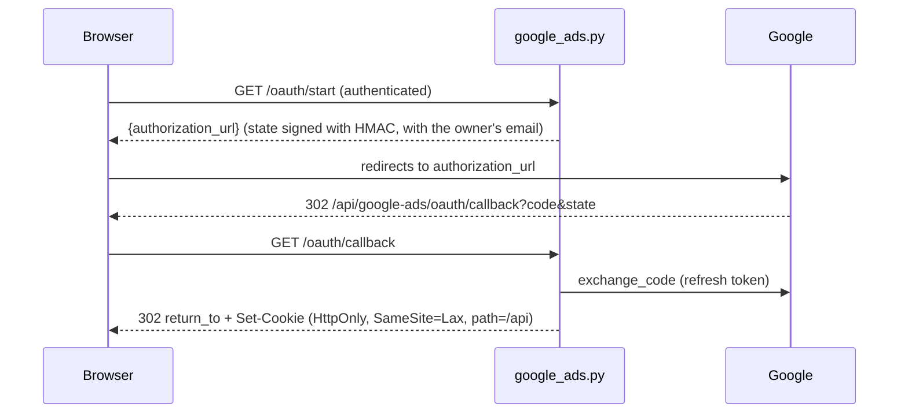

# Google Ads router

Prefix `/api/google-ads`. Router: `backend/routers/google_ads.py`, with two `APIRouter`s: `router` (authenticated) and `oauth_callback_router` (public, `:171`, registered in `main.py:40`). Services: `google_ads_oauth_service.py` (OAuth and cookie), `google_ads_api_service.py` (live API), `google_ads_service.py` (CSV). See [Google OAuth](../integracoes/google-oauth.md) and [Google Ads](../integracoes/google-ads.md).

## Routes

| Method | Path | Auth | Input | Response | Errors |
|---|---|---|---|---|---|
| GET | `/oauth/start` (`:48`) | yes | query `return_to` (relative path only; default `/?google_ads=connected`) | `{"authorization_url"}` | 503 |
| GET | `/oauth/callback` (`:59`) | no | query `state`, `code?`, `error?` | 302 redirect + cookie | never an HTTP error (redirects) |
| GET | `/connection` (`:88`) | yes | cookie `gtm_google_ads_session`* | `{"configured","missing_settings","connected"}` | n/a |
| DELETE | `/connection` (`:103`) | yes | cookie | `{"connected":false,"revoked"}` | n/a |
| GET | `/accounts` (`:119`) | yes + cookie | n/a | accessible accounts | 401, Google (`status_code`) |
| POST | `/analyze-live` (`:131`) | yes + cookie | `LiveAnalysisBody` | canonical result | 401, 422, Google |
| POST | `/analyze` (`:162`) | yes | multipart CSVs | conversion actions | 400 |

\* The cookie is `gtm_google_ads_session` (`GOOGLE_ADS_COOKIE`, `google_ads_oauth_service.py:24`); the session shares the cookie with GTM and GA4.

`LiveAnalysisBody` (`:30-36`): `customer_id`, `login_customer_id?`, `start_date?`, `end_date?`, `project_id?`, `report_id?`. `/analyze`: `conversion_actions` (required), `custom_goals_config?`, `goal_config?`, `customer_id?`.

## OAuth



The `state` is signed with HMAC-SHA256 and an external `return_to` is replaced by the default. It is created in `create_state` (`google_ads_oauth_service.py:78`) and validated/expired in `read_state` (`:91`). The cookie holds the encrypted connection (Fernet, `:65`) and `read_connection` (`:176`) checks that the cookie belongs to the current user's email. The callback is public because the browser arrives from Google without an auth header; the `state` is what guarantees identity.

## Live analysis

`analyze_google_ads_live` (`google_ads.py:131-159`) runs `analyze_live_account` in a threadpool. With `project_id` and `report_id`, it writes a `live` run and, if saved, records the ids in the project's `google_accounts` (`record_google_accounts`) and calls `save_google_ads_analysis_safe`. Period: complete days, in order, at most 366 days (`ValueError` becomes 422). MCCs are expanded into client accounts.

`GoogleAdsApiError` carries `status_code` and `request_id`; the router returns `detail={"message","request_id"}`.

## Example

```bash
curl -b "<cookie_da_sessao>" -X POST http://localhost:8000/api/google-ads/analyze-live \
  -H "Authorization: Bearer <id_token>" -H "Content-Type: application/json" \
  -d '{"customer_id":"1234567890","start_date":"2026-01-01","end_date":"2026-01-31"}'
```

```bash
curl -X POST http://localhost:8000/api/google-ads/analyze \
  -H "Authorization: Bearer <id_token>" \
  -F "conversion_actions=@acoes.csv" -F "customer_id=1234567890"
```

## Caveats

- No cookie, or a cookie from another user: 401 (`_connection`, `:41-45`). The connection "needs to be renewed" if GTM/GA4 scopes are missing.
- The callback never returns an error JSON: it always redirects to `/?google_ads=error&message=...`.
- `Secure` on the cookie only in `prod`/`production` (`:79-85`); in dev it travels without HTTPS.
- `DELETE /connection` clears the cookie on the `/api` and `/api/google-ads` paths (legacy) and reports `revoked` according to the revocation at Google.
- `/analyze` catches any exception as 400, including CSVs above 10 MB and missing columns (`google_ads_service.py:42,237`).
- In-memory cache of accessible accounts per refresh token (`google_ads_api_service.py:60-73`).
