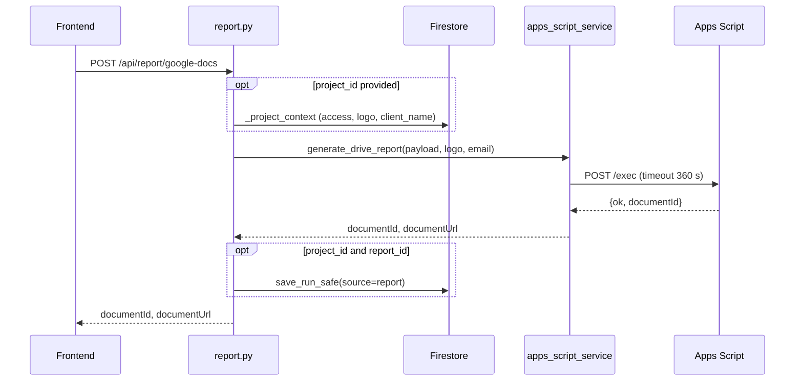

# Report router

Prefix `/api/report`, authenticated. Router: `backend/routers/report.py`. Services: `backend/services/apps_script_service.py` (`generate_drive_report`) and `backend/services/drive_service.py` (publisher account). Full flow in [Generation flow](../geracao-do-documento/fluxo-de-geracao.md) and [Apps Script](../integracoes/apps-script.md).

## Routes

| Method | Path | Input | Response | Errors |
|---|---|---|---|---|
| POST | `/api/report/google-docs` (`report.py:31`) | `{"payload": {...}, "project_id?", "report_id?"}` | `{"documentId","documentUrl"}` | 404, 422, 502, 503, 504 |
| GET | `/api/report/publisher-status` (`report.py:50`) | n/a | `{"configured": bool, "healthy": bool}` | n/a |

## `google-docs` flow



1. With `project_id`, `_project_context` (`report.py:21-28`) requires access (404 otherwise), takes the project's `logo_base64` and, if the payload has no `client_name`, uses the project's.
2. `generate_drive_report` (`apps_script_service.py:18`) validates config, collections and logo, computes month/year from `snapshot_date`, obtains a token for the publisher account and `POST`s to the Web App with `{secret, payload, client_logo_base64}`.
3. With `project_id` and `report_id`, it writes a `report` run with the document ids; `save_run` changes the report to `status: "generated"`.

## Apps Script errors

| Status | Cause | Line |
|---|---|---|
| 503 | Missing variables or a URL that is not `/exec` | `apps_script_service.py:24,26` |
| 422 | Invalid collection or invalid logo (PNG/JPEG/GIF, up to 5 MB) | `:31,45` |
| 502 | Token renewal failure, HTTP 4xx/5xx from the Web App, transport failure, non-JSON response, `ok != true`, invalid `documentId` | `:58-88` |
| 504 | Timeout (360 s) | `:66` |

## Example

```bash
curl -X POST http://localhost:8000/api/report/google-docs \
  -H "Authorization: Bearer <id_token>" -H "Content-Type: application/json" \
  -d '{"payload":{"client_name":"Cliente Exemplo","snapshot_date":"2026-01-15T00:00:00Z"},
       "project_id":"<project_id>","report_id":"<report_id>"}'
# {"documentId":"<doc_id>","documentUrl":"https://docs.google.com/document/d/<doc_id>/edit"}
```

## Caveats

- On 504 the document **may have been created**: check the Drive folder before generating again (the backend's own message). See [Timeout and errors](../geracao-do-documento/timeout-e-erros.md).
- The payload sent to Apps Script is the enriched one (`document_owner_email`, `document_month`, `document_year`), but the saved run keeps the request's `payload` (with `client_name` filled in, without the document fields).
- `publisher-status` only calls `check_publisher_health` if `is_publisher_configured()`; it reflects the publisher account, not the user's Google connection.
- If `save_run_safe` fails, the document already exists and the response is still 200.
