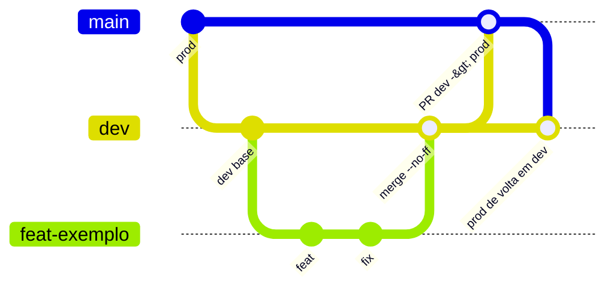

# Git and commits

Rules from `AGENTS.md`, `CLAUDE.md` and the app README ("Fluxo Git para desenvolvimento solo", Git flow for solo development), checked against `git log`. They apply to **new** work; the existing history is preserved.

## Branch model

- `dev`: integration and base for every task (default branch on GitHub, `origin/HEAD -> origin/dev`).
- `prod`: code approved for production.
- Never develop directly on `dev` or `prod`.
- One task branch at a time: `feat/`, `fix/`, `hotfix/`, `refactor/`, `docs/` or `chore/` + a short description in English, lowercase, kebab-case. No AI/tool prefix. `chore/` also for isolated tests or CI. No release branches.

(In the diagram, `main` represents `prod`.)

## Step by step

1. Check the branch and working tree; preserve pending changes and stashes.
2. `git switch dev && git pull --ff-only`, then create the task branch.
3. To update the task branch, **merge** `dev` into it.
4. Before integrating: review the diff and run backend tests, frontend tests and `npm run build` ([Tests](./testes.md)).
5. Integrate into `dev` locally with `git merge --no-ff`.
6. Promote `dev` to `prod` via PR with "Create a merge commit". The solo dev reviews and completes it; a second reviewer is not required. Then merge the updated `prod` into `dev`.
7. Delete the task branch only after integration is confirmed.

**Hotfix:** `hotfix/*` starts from an updated `prod`, enters `prod` via PR and returns to `dev` by merging `prod`.

**Forbidden:** rebase, squash, force-push, reset to rewrite history. Divergence is resolved with a merge. Pull only with `--ff-only`.

**Legacy branches** (`master`, `Database_integration`, `app-scripts-integration`, `new_template_and_application_changes`): do not resume or merge what is exclusive to them without review.

## Conventional Commits

Format: `<type>(<optional scope>): <imperative description, in English>`, including in merges made by humans.

Count over 73 commits of the current history (`git log` from HEAD):

| Type | Count |
|---|---|
| `fix` | 26 |
| `feat` | 25 |
| `refactor` | 10 |
| `docs` | 2 |
| `chore` | 2 |
| `build` | 1 |
| non-conforming | 7 |

Scopes actually in use: `appscript` (5, plus the variants `appscripts` and `apps-script`), `frontend` (5), `google-ads` (4), `deploy` (3), `report` (3), `transcripts`, `gtm-audit`, `ga4`, `crawler`, `auth`, `audit` (2 each), plus `projects`, `persistence`, `observepoint`, `oauth`, `makefile`, `git`, `services`, `router`, `considerations`, `cleanup` and other single-use ones. There is no closed list; prefer an existing scope and write it consistently (`google-ads`, not `GAds`).

### Good examples from the history

- `feat(projects): split client/project name and auto-record Google accounts`
- `fix(appscript): omit empty tables, forms list and considerations`
- `refactor(appscript): restructure EC and offline sections with subsections`

### Bad examples (they exist in the history; do not repeat)

| Commit | Problem |
|---|---|
| `Create CLAUDE.md`, `Create AGENTS.md` | no type (GitHub's default message) |
| `CI(prod): changes to ...` | uppercase type that does not exist in the vocabulary |
| `BREAKING CHANGE: replace /api/report/docx ...` | no type/scope; the `BREAKING CHANGE:` footer should accompany a `feat!`/`refactor!` |
| `fix(appscripts) : adding the footer` | space before the colon and a gerund verb |
| `fix(GAds): ...` | scope not in kebab-case |
| `First Commit` | no type |

## Practice vs rule

- There is only **one** real merge commit in the history: `375c312 Merge branch 'feat/apps-script-reports' into dev ...` (and it does not follow the format either). Most of the history is linear, predating the adoption of the flow.
- `prod` is behind `dev`: `dev` has 14 commits that `prod` does not have and `prod` has no exclusive commits.
- Old branches are still present (`refator/documentation-and-ai-use`, with a typo in the prefix, besides the legacy ones listed above).
- 7 of 73 messages do not follow Conventional Commits.

## Pull requests

Explain changes and verification, link the issue when there is one, attach screenshots for visible UI changes and highlight changes to the API, payload, template or environment variables.

## Rules for AI

- AI **does not commit** (nor merge). It reports changed files, checks run and **suggests** a Conventional Commit message.
- AI never deploys or pushes to production ([Deploy](./deploy.md)).
- Inspect the branch and working tree before editing; do not discard or mix pending changes. More in [AGENTS.md and CLAUDE.md](../ia-e-agentes/agents-md.md).
