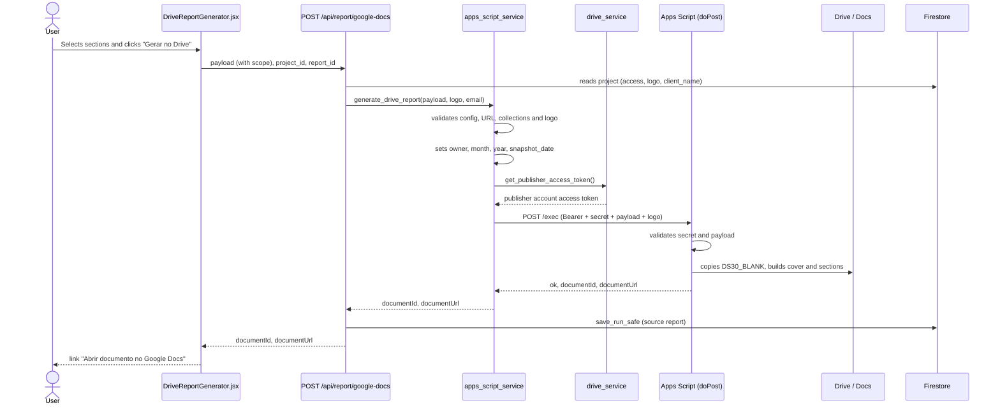

# Generation flow

The final diagnostic is a Google Doc created by an Apps Script Web App. The FastAPI backend only validates, completes the payload and forwards the call.

## Sequence view



## Steps

1. **Frontend.** `DriveReportGenerator` (`frontend/src/components/DriveReportGenerator.jsx`) shows the pending decisions and the section checkboxes (`SECTION_TOGGLES`). Each checkbox calls `withSectionToggle`, which writes `payload.scope` (see [Payload v3](./payload-v3.md)). The button calls `generateDriveReport` in `frontend/src/services/api.js:121`, which sends `{payload, project_id, report_id}` with the authentication headers.
2. **Route.** `generate_google_doc` in `backend/routers/report.py:31` requires an authenticated user. With `project_id`, it loads the project (404 if it does not exist or no access, `backend/routers/report.py:21`), uses the project's `logo_base64` and fills in `client_name` if the payload does not carry one. The logo does not come from the request.
3. **Service.** `generate_drive_report` (`backend/services/apps_script_service.py:18`) runs the checks below.
4. **Apps Script.** `doPost` (`Docs/ds30_appscript/Main.js:70`) checks the secret and calls `generateDs30`. Details in [Apps Script internals](./apps-script-por-dentro.md).
5. **Persistence.** If `project_id` and `report_id` were sent, `save_run_safe` writes the run (`source='report'`) with the original payload, the email and the document (`backend/routers/report.py:42`). It is best-effort: a Firestore failure does not bring down the response (`backend/services/firestore_service.py:116`).

## Order of checks in the service

| # | Check | Line | Failure |
|---|---|---|---|
| 1 | `DS30_APPS_SCRIPT_URL`, `DS30_APPS_SCRIPT_SECRET` and publisher account credentials present | `apps_script_service.py:21` | 503 |
| 2 | URL matches the pattern `https://script.google.com/.../exec` | `apps_script_service.py:25` | 503 |
| 3 | Collections are lists of objects (`gtm_containers`, `gtm_variables`, `gtm_tags`, `platform_accounts`, `conversion_actions`, `matching_signals`, `upd_form_urls`, `changelog_entries`, `analyzed_urls`, `cdns`) | `apps_script_service.py:27` | 422 |
| 4 | Logo: PNG/JPEG/GIF, up to 5 MB, valid base64, real format matches the MIME | `apps_script_service.py:32` | 422 |
| 5 | Server-defined fields: `document_owner_email` (from the session), `document_month` (in pt-BR), `document_year`, normalized `snapshot_date` (uses now if invalid) | `apps_script_service.py:46` | n/a |
| 6 | Publisher account token (`get_publisher_access_token`) | `apps_script_service.py:55` | 502 |
| 7 | POST with `httpx`, 360 s timeout (10 s connect), follows redirects | `apps_script_service.py:59` | 502/504 |
| 8 | JSON response with `ok: true` and a valid `documentId` | `apps_script_service.py:82` | 502 |

Checks 1 to 6 happen before any call to Apps Script. The codes and what to do for each are in [Timeout and errors](./timeout-e-erros.md).

## Response

```json
{"documentId": "...", "documentUrl": "https://docs.google.com/document/d/<id>/edit"}
```

The URL is built by the backend from the `documentId`, not passed through from the script (`apps_script_service.py:89`).

## Publisher account health

`GET /api/report/publisher-status` (`backend/routers/report.py:50`) returns `{configured, healthy}`: it tries to renew the publisher account token, without touching Apps Script.

See also: [Apps Script integration](../integracoes/apps-script.md), [Report API](../api/report.md), [Environment variables](../referencia/variaveis-de-ambiente.md).
