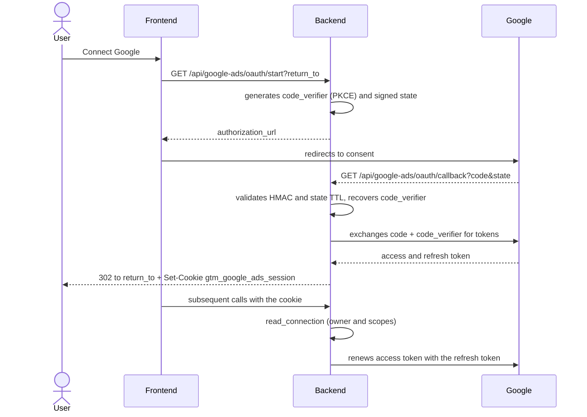

# Google OAuth (Ads, GTM and GA4)

A single connection per user serves Google Ads, GTM and GA4. The implementation is in `backend/services/google_ads_oauth_service.py` and the routes in `backend/routers/google_ads.py`. The name "Google Ads" stayed in the code for historical reasons. This connection is different from the publisher account that generates the document (see [Apps Script](./apps-script.md)).

## Scopes

| Scope | Use |
|---|---|
| `https://www.googleapis.com/auth/adwords` | Google Ads |
| `https://www.googleapis.com/auth/tagmanager.readonly` | GTM |
| `https://www.googleapis.com/auth/analytics.readonly` | GA4 |

Constants in `google_ads_oauth_service.py:20` to `:23`. The flow requests `access_type=offline` and `prompt=consent` to always obtain a refresh token (`:130`).

## Environment variables (names only)

`GOOGLE_CLIENT_ID`, `GOOGLE_CLIENT_SECRET`, `GOOGLE_ADS_OAUTH_REDIRECT_URI`, `GOOGLE_ADS_SESSION_ENCRYPTION_KEY` for OAuth (`:27`); Google Ads also requires `GOOGLE_ADS_DEVELOPER_TOKEN` (`:33`). `GET /api/google-ads/connection` reports `configured` and `missing_settings` (names only). See [Environment variables](../referencia/variaveis-de-ambiente.md).

## Flow

## Security pieces

- **PKCE.** `build_authorization_url` generates a random `code_verifier` (`:125`); it travels inside the `state`, encrypted with Fernet (`:85`), and is recovered in `exchange_code` (`:141`).
- **Signed state.** `create_state` (`:78`) serializes `owner` (lowercase email), `return_to`, `issued_at` and the verifier, signing with HMAC-SHA256 using `GOOGLE_ADS_SESSION_ENCRYPTION_KEY`. `read_state` (`:91`) compares the signature in constant time and rejects state older than `STATE_TTL_SECONDS = 600` s (or more than 30 s in the future).
- **`return_to`.** Only accepted if it starts with `/` and not `//` (a path relative to the site itself); otherwise it falls back to `/?google_ads=connected` (`:81`).
- **Cookie `gtm_google_ads_session`.** The refresh token **exists only in this cookie**: the content (`refresh_token`, `owner`, `scopes`, `issued_at`) is encrypted with Fernet, whose key is derived by SHA-256 from the session key (`:65`, `:167`). There is no copy in Firestore. Attributes: `httponly`, `samesite=lax`, `path=/api`, `secure` only when `ENVIRONMENT` is `prod`/`production` (`backend/routers/google_ads.py:77`). The callback deletes the old cookie with `path=/api/google-ads` so it does not shadow the new one.
- **`read_connection`** (`:176`) decrypts the cookie and requires that `owner` be the authenticated session's email and that all three scopes be present. A cookie from another user or an old connection with only Ads returns an error (the route converts it to 401, `backend/routers/google_ads.py:41`), asking for reconnection.
- **Revocation.** `DELETE /api/google-ads/connection` calls `revoke_connection` (`:203`), which sends the refresh token to Google's revocation endpoint (200 or 400 count as revoked) and always removes the cookie.

## Common callback errors

The callback never returns JSON: it redirects to `/?google_ads=error&message=...` (`backend/routers/google_ads.py:59`). Handled messages: expired or reused code (`invalid_grant`), `redirect_uri_mismatch`, Google refusal, network failure and missing refresh token (revoke the previous access and reconnect). The redirect URI registered in the OAuth client must be identical to `GOOGLE_ADS_OAUTH_REDIRECT_URI`; see [Firebase and GCP](./firebase.md) for the console step-by-step.

Related: [Authentication](../visao-geral-e-arquitetura/autenticacao.md), [Google Ads API](../api/google-ads.md), [Google platforms API](../api/google-platforms.md).
