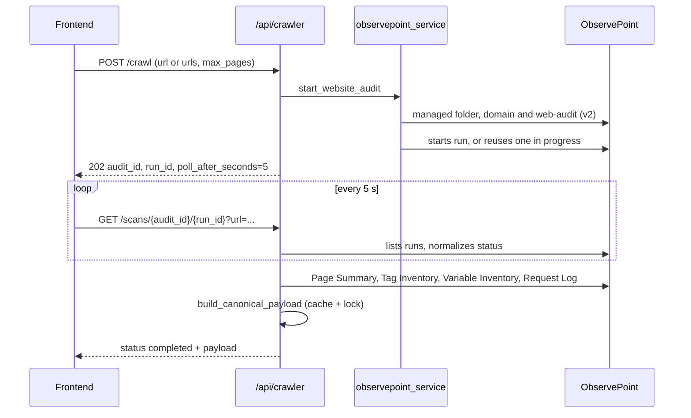

# ObservePoint

The crawler uses the ObservePoint API to audit the client's pages and turn the run's reports into part of the [payload v3](../geracao-do-documento/payload-v3.md). Files: `backend/services/crawler_service.py` (entry), `backend/services/observepoint_service.py` (API and payload), `backend/services/cdn_analyzer.py` and `backend/services/gtm_request_analyzer.py` (analyses). Routes in `backend/routers/crawler.py` (see [Crawler API](../api/crawler.md)); all require an authenticated user (`backend/main.py:46`). Configuration: variables `OBSERVEPOINT_API_KEY` (header `Authorization: api_key ...`, `observepoint_service.py:13`) and `OBSERVEPOINT_BASE_URL`.

## Flow

## Start: `start_website_audit`

`crawler_service.py:33`:

1. Requires `OBSERVEPOINT_API_KEY`.
2. Normalizes URLs (`normalize_url`, `:5`): HTTP/HTTPS required, no credentials, no fragment. With an exact list of URLs, the page limit is the count; with one URL, `max_pages` applies (default 10).
3. Queries the account limit (`get_account_page_limit`, `observepoint_service.py:152`) and rejects if exceeded.
4. `ensure_managed_audit` and `start_or_reuse_run`.

## Managed audit

`ensure_managed_audit` (`observepoint_service.py:166`) only touches the app's own resources:

- Uses (or creates) the `GTM Analyzer App` folder (`MANAGED_FOLDER_NAME`), the domain with the hostname inside it and the first web-audit of that domain. If it does not exist, it creates it with `frequency: once`, a filter that includes only the hostname, Chrome/Linux, location `brazil` and `fireTags: true`.
- If the starting URLs or the limit changed, it updates the audit with `PUT` (which requires the full object). If there is already a queued or running run **with a different configuration**, it fails with a message asking to wait.

`start_or_reuse_run` (`:270`) returns the run in progress (`reused_running_run: true`) or creates a new one.

## Polling and status

`GET /scans/{audit_id}/{run_id}` (`backend/routers/crawler.py:101`) keeps no state: it fetches the run and normalizes with `normalize_run_status` (`observepoint_service.py:260`):

| Normalized status | When |
|---|---|
| `completed` | `complete`, `completed`, `finished`, `success`, `succeeded`, or `completedAt`/`completed` present |
| `failed` | `failed`, `failure`, `error`, `cancelled`, `canceled`, `aborted` |
| `running` | `running`, `in_progress`, `processing`, `started`, or `started` present |
| `queued` | any other value (default) |

On `completed`, the route builds the payload; with `project_id` and `report_id` it writes the run (`source="crawler"`). On `failed`, it returns `detail`.

## Canonical payload

`build_canonical_payload` (`:492`) with `_build_canonical_payload_uncached` (`:541`):

- **Cache and lock.** With `run_id`, the result is kept in `_payload_cache` (key: type, id, run, target URL), protected by `asyncio.Lock`. Concurrent polls of the same run share a single `asyncio.Task` (`_payload_tasks`); if the task fails, it is removed and the next call tries again. The cache is per instance and without expiry, in memory.
- **Reports read** (all `v3`, 20 s timeout): Page Summary (pages), Tag Inventory, Variable Inventory (with accounts) and the Request Log per page (`fetch_page_requests`). A failure in a page's request log does not bring down the payload: it marks a failed verification and the CDN may come out `inconclusive`.
- **Fields filled:** `analyzed_urls` (with `url_type` inferred from `cart/carrinho`, `checkout`, `login`), `client_url`, `client_server` and `client_reverse_proxy` (`Server`/`Via` headers), `client_tag_manager` and `client_cookie_manager` (detection by name/ID), GA4 `platform_accounts` by regex (Google Ads accounts are filtered out), `upd_variables_identified` (variables with names such as email/phone/user_data), `upd_form_urls` (checkout and login pages), `cdns`, `cdn_analysis_status`, `gtm_observations`, `gtg_implemented`, `server_side_gtm_used`, plus scalar aliases and `derive_decision_fields` (`:906`).
- **Does not feed** `gtm_containers`, `gtm_variables` and `gtm_tags`: that data stays with the official integrations ([GTM and GA4](./google-tag-manager-e-ga4.md)), see `Docs/observepoint_field_overlap.md`.

## `cdn_analyzer.py`

`analyze_cdns` groups evidence by provider, with the name of the source page:

| Method | Evidence |
|---|---|
| `http_headers` | Page headers (`detect_cdn_from_headers`, for example `cf-ray`, `x-amz-cf-id`, `x-akamai-transformed`) |
| `dns_cname` | CNAME chain (up to 5 hops, 3 s timeout) of the page host and of first-party hosts from the request log, matched against known suffixes |
| `ip_asn` | ASN of the server IP (DNS query to Team Cymru), for Azion, Cloudflare, Akamai and Fastly |

Confidence: `confirmed` (there is a header), `infrastructure_detected` (ASN) and `dns_only`. Overall status: the lowest confidence among the CDNs, `no_cdn` if nothing was found and `inconclusive` if there was a verification error. DNS resolution runs with at most 5 hosts in parallel.

## `gtm_request_analyzer.py`

`analyze_gtm_requests` examines the request log URLs: `gtm.js` with `GTM-` indicates a container (web if the host is `googletagmanager.com`, server otherwise, with endpoint); `gtag/js` with `G-`/`AW-`/`GT-` indicates a Google tag, and a non-Google host indicates Tag Gateway (`gtg_implemented`). Returns `gtm_observations` with `deployment` (`web`, `server`, `client-side`, `gateway`). Without requests, `gtg_implemented` and `server_side_gtm_used` stay `None`.

## About the supporting documents

- `Docs/doc_observepoint.md` is a copy of the ObservePoint API v2 reference (fields for folders, domains, audits); it does not describe the app's code.
- `Docs/observepoint_field_overlap.md` describes the decision not to let ObservePoint overwrite GTM and Ads. Checked: the current code matches (`observepoint_service.py:857` onwards). The GA4 part still comes from ObservePoint, as the document itself admits.

Tests: `backend/tests/test_observepoint_service.py`, `test_crawler_service.py`, `test_cdn_analyzer.py`, `test_gtm_request_analyzer.py`.
