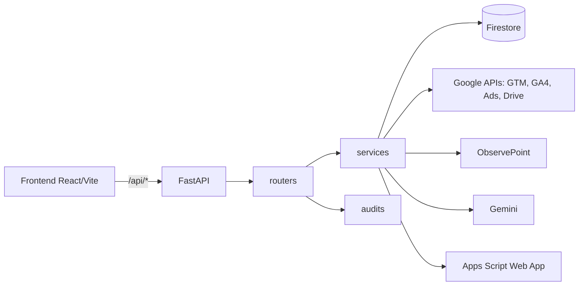
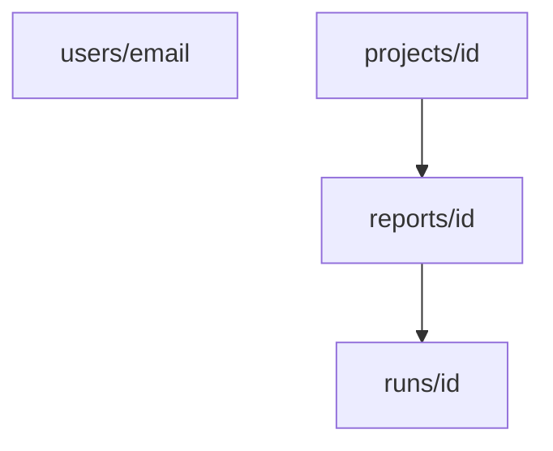

# Architecture

## Components

- All routers, except `auth` and the Google Ads OAuth callback, are mounted with `Depends(get_current_user)` (`backend/main.py:39-49`).
- CORS uses `ALLOWED_ORIGINS` (`backend/main.py:31`).
- `GET /health` and `GET /api/health` respond `{"status": "ok"}` (`backend/main.py:51-54`).
- In development, Vite (port 5173) proxies `/api` to `localhost:8000` (`frontend/vite.config.js`).

## SPA served by the backend

The `Dockerfile` has two stages: `node:20-alpine` runs `npm run build` and `python:3.11-slim` copies the result to `backend/static`. If `backend/static` exists, `main.py` mounts `/assets` and a catch-all route returns the requested file or `index.html` (`backend/main.py:57-68`). Without the folder, `/` returns only a status JSON. The image also copies the `.docx` template and the variable mapping from `Docs/`. The process listens on `$PORT` (default 8080).

## Firestore model

Database `gtm-analyzer`, accessed only by the backend with default credentials (ADC). Field-by-field details are in the [Data dictionary](../referencia/dicionario-de-dados.md).

- `users/{email}`: mirror of the login profile.
- `projects/{id}`: top-level collection (shareable projects); `owner_email` and `member_emails` control access.
- `projects/{id}/reports/{id}` and `.../runs/{id}`: reports and an immutable history of runs.

## Flow of a typical action: generating the diagnostic

1. The frontend calls `POST /api/report/google-docs` with `payload`, `project_id` and `report_id`; `api.js` attaches the authentication headers.
2. `get_current_user` validates the user (see [Authentication](./autenticacao.md)).
3. The router checks project access (404 if none), reads the logo and fills in `client_name` (`backend/routers/report.py:31-45`).
4. `generate_drive_report` validates `DS30_APPS_SCRIPT_URL` and the secret and calls Apps Script (360 s timeout) (`backend/services/apps_script_service.py`).
5. `save_run_safe` writes a `run` with `source="report"` and marks the report as `generated`.
6. The response returns `documentId` and `documentUrl`.

Details in [Generation flow](../geracao-do-documento/fluxo-de-geracao.md).

## Per-instance caches and state

Some state lives in process memory and is **not shared** between Cloud Run instances nor does it survive a restart:

- OTP, email sessions and rate limit (`backend/services/auth_service.py:16-27`).
- Google Ads accounts cache, 300 s TTL (`backend/services/google_ads_api_service.py:57-73`).
- ObservePoint canonical payload cache (`backend/services/observepoint_service.py:33`).

With more than one instance, an OTP login can fail if verification lands on a different instance. Persisting to Firestore is the natural evolution, if needed.
