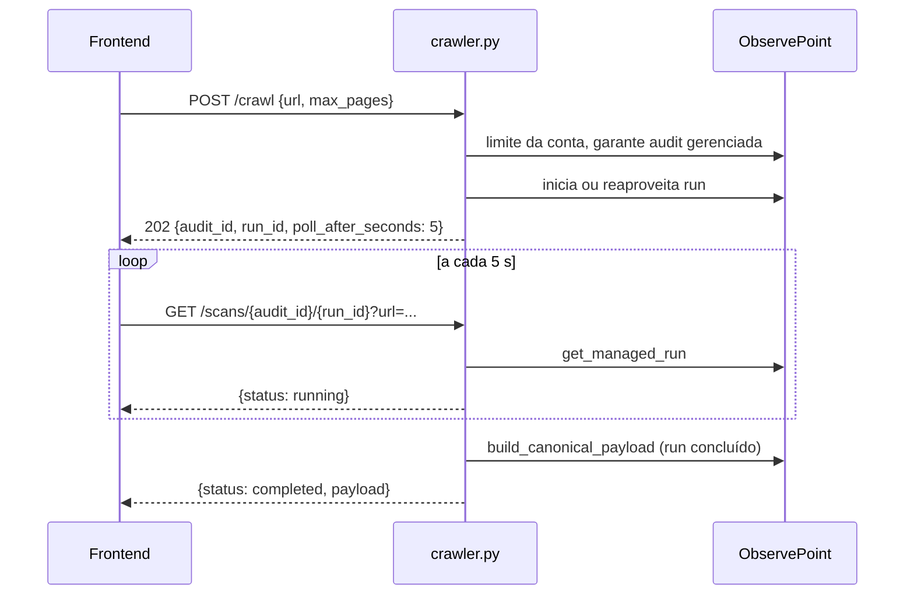

# Router Crawler

Prefijo `/api/crawler`, autenticado. Router: `backend/routers/crawler.py`. Servicios: `backend/services/crawler_service.py` (normalización e inicio) y `backend/services/observepoint_service.py` (cliente REST). Ver [ObservePoint](../integracoes/observepoint.md).

## Rutas

| Método | Ruta | Entrada | Respuesta | Errores |
|---|---|---|---|---|
| GET | `/api/crawler/status` (`:53`) | n/d | `{"status","engine","observepoint":{...}}` | n/d |
| GET | `/api/crawler/observepoint/audits` (`:63`) | query `size` (1-100, predeterminado 50), `page` (>=0) | `{"audits":[...]}` | 400, 500 |
| GET | `/api/crawler/observepoint/journeys` (`:74`) | ídem | `{"journeys":[...]}` | 400, 500 |
| POST | `/api/crawler/crawl` (`:85`, 202) | `CrawlRequest` | `{"status":"queued","audit_id","run_id","poll_after_seconds":5,"reused_running_run","starting_urls"}` | 401/403, 409, 422, 500, 502 |
| GET | `/api/crawler/scans/{audit_id}/{run_id}` (`:100`) | query `url` (obligatoria), `project_id?`, `report_id?` | `{"status","audit_id","run_id","poll_after_seconds"}` + `payload` o `detail` | 422, 401/403, 409, 500, 502 |

`CrawlRequest` (`:16-39`): `url` **o** `urls` (exactamente uno; ambos o ninguno da 422), `max_pages` (>0, predeterminado 10). Las strings en blanco se rechazan y se recortan.

## Inicio y polling



`start_website_audit` (`crawler_service.py:33`): exige `OBSERVEPOINT_API_KEY`; con `urls`, el límite de páginas pasa a ser `len(urls)`; si no, usa `max_pages`. Compara con el límite de la cuenta (`get_account_page_limit`), llama a `ensure_managed_audit` y `start_or_reuse_run`. `reused_running_run` indica que ya había una ejecución en curso.

`poll_scan` es stateless: normaliza la URL, busca el run y mapea el estado con `normalize_run_status`. En `failed` devuelve `detail`; en `completed` arma el payload canónico para ese `run_id` y, si llegaron `project_id` y `report_id`, guarda un run `crawler` (`crawler.py:121-124`).

## Mapa de errores upstream

`_upstream_error` (`crawler.py:41-51`):

| Upstream | Respuesta |
|---|---|
| 401/403 | mismo estado, "Sem permissão para configurar ou executar auditorias no ObservePoint." (Sin permiso para configurar o ejecutar auditorías en ObservePoint.) |
| 422 | 422, URL o configuración rechazada |
| 409/429 con `quota`/`limit`/`capacity` en el mensaje | 409, cuota alcanzada |
| otros | 502 `Falha na API do ObservePoint: ...` (Falla en la API de ObservePoint) |

`ValueError` (URL inválida, límite excedido, clave ausente) se convierte en 422. Cualquier otra excepción, 500.

## Ejemplo

```bash
curl -X POST http://localhost:8000/api/crawler/crawl \
  -H "Authorization: Bearer <id_token>" -H "Content-Type: application/json" \
  -d '{"url":"https://www.exemplo.com","max_pages":10}'
# 202 {"status":"queued","audit_id":123,"run_id":456,"poll_after_seconds":5,
#      "reused_running_run":false,"starting_urls":["https://www.exemplo.com/"]}

curl -H "Authorization: Bearer <id_token>" \
  "http://localhost:8000/api/crawler/scans/123/456?url=https://www.exemplo.com&project_id=<project_id>&report_id=<report_id>"
```

## Puntos de atención

- `/status`, `/observepoint/*` y `/crawl` no declaran el `user`, solo dependen del `Depends` del router; únicamente `/scans` usa el correo (para `save_run_safe`).
- `normalize_url` rechaza esquemas no HTTP(S) y credenciales en la URL (`crawler_service.py:12-14`).
- Clave ausente: `/observepoint/*` devuelve 400, pero `/crawl` devuelve 422 (llega como `ValueError`).
- Cada nuevo polling `completed` guarda otro run si el front sigue llamando; detenga el bucle al recibir `completed`.
- `size`/`page` tienen tope 100 en la query; los errores genéricos en los listados se convierten en 500, no en 502.
