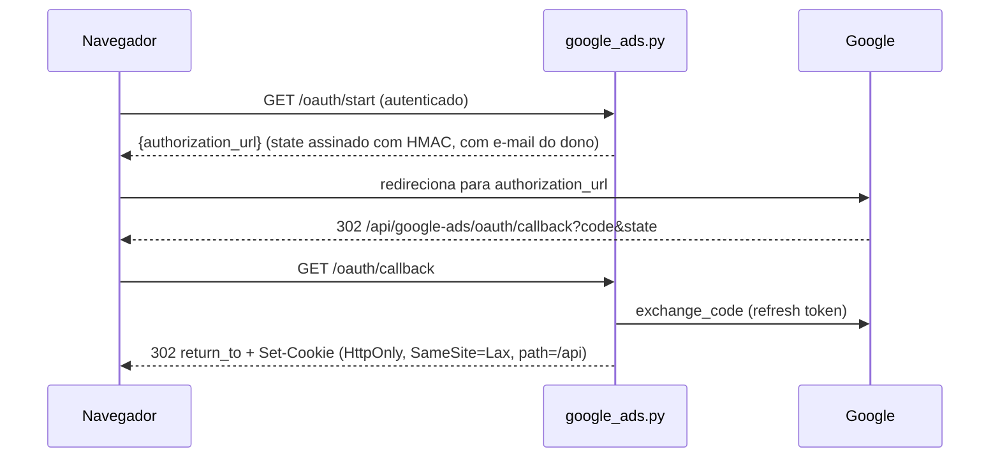

# Router Google Ads

Prefijo `/api/google-ads`. Router: `backend/routers/google_ads.py`, con dos `APIRouter`: `router` (autenticado) y `oauth_callback_router` (público, `:171`, registrado en `main.py:40`). Servicios: `google_ads_oauth_service.py` (OAuth y cookie), `google_ads_api_service.py` (API en vivo), `google_ads_service.py` (CSV). Ver [Google OAuth](../integracoes/google-oauth.md) y [Google Ads](../integracoes/google-ads.md).

## Rutas

| Método | Ruta | Auth | Entrada | Respuesta | Errores |
|---|---|---|---|---|---|
| GET | `/oauth/start` (`:48`) | sí | query `return_to` (solo ruta relativa; predeterminado `/?google_ads=connected`) | `{"authorization_url"}` | 503 |
| GET | `/oauth/callback` (`:59`) | no | query `state`, `code?`, `error?` | redirect 302 + cookie | nunca error HTTP (redirige) |
| GET | `/connection` (`:88`) | sí | cookie `gtm_google_ads_session`* | `{"configured","missing_settings","connected"}` | n/d |
| DELETE | `/connection` (`:103`) | sí | cookie | `{"connected":false,"revoked"}` | n/d |
| GET | `/accounts` (`:119`) | sí + cookie | n/d | cuentas accesibles | 401, Google (`status_code`) |
| POST | `/analyze-live` (`:131`) | sí + cookie | `LiveAnalysisBody` | resultado canónico | 401, 422, Google |
| POST | `/analyze` (`:162`) | sí | multipart CSVs | acciones de conversión | 400 |

\* La cookie es `gtm_google_ads_session` (`GOOGLE_ADS_COOKIE`, `google_ads_oauth_service.py:24`); la sesión comparte la cookie con GTM y GA4.

`LiveAnalysisBody` (`:30-36`): `customer_id`, `login_customer_id?`, `start_date?`, `end_date?`, `project_id?`, `report_id?`. `/analyze`: `conversion_actions` (obligatorio), `custom_goals_config?`, `goal_config?`, `customer_id?`.

## OAuth



El `state` se firma con HMAC-SHA256 y un `return_to` externo se reemplaza por el predeterminado. Se crea en `create_state` (`google_ads_oauth_service.py:78`) y se valida/expira en `read_state` (`:91`). La cookie guarda la conexión cifrada (Fernet, `:65`) y `read_connection` (`:176`) verifica que la cookie pertenezca al correo del usuario actual. El callback es público porque el navegador llega desde Google sin header de auth; quien garantiza la identidad es el `state`.

## Análisis en vivo

`analyze_google_ads_live` (`google_ads.py:131-159`) ejecuta `analyze_live_account` en threadpool. Con `project_id` y `report_id`, guarda un run `live` y, si se guardó, registra los ids en `google_accounts` del proyecto (`record_google_accounts`) y llama a `save_google_ads_analysis_safe`. Período: días completos, en orden, máximo 366 días (`ValueError` → 422). Las MCCs se expanden a cuentas de cliente.

`GoogleAdsApiError` lleva `status_code` y `request_id`; el router devuelve `detail={"message","request_id"}`.

## Ejemplo

```bash
curl -b "<cookie_da_sessao>" -X POST http://localhost:8000/api/google-ads/analyze-live \
  -H "Authorization: Bearer <id_token>" -H "Content-Type: application/json" \
  -d '{"customer_id":"1234567890","start_date":"2026-01-01","end_date":"2026-01-31"}'
```

```bash
curl -X POST http://localhost:8000/api/google-ads/analyze \
  -H "Authorization: Bearer <id_token>" \
  -F "conversion_actions=@acoes.csv" -F "customer_id=1234567890"
```

## Puntos de atención

- Sin cookie o con cookie de otro usuario: 401 (`_connection`, `:41-45`). La conexión "necesita renovarse" si faltan scopes de GTM/GA4.
- El callback nunca devuelve JSON de error: siempre redirige a `/?google_ads=error&message=...`.
- `Secure` en la cookie solo en `prod`/`production` (`:79-85`); en dev viaja sin HTTPS.
- `DELETE /connection` limpia la cookie en los paths `/api` y `/api/google-ads` (heredado) e informa `revoked` según la revocación en Google.
- `/analyze` captura cualquier excepción como 400, incluido un CSV de más de 10 MB y columnas ausentes (`google_ads_service.py:42,237`).
- Caché de cuentas accesibles por refresh token en memoria (`google_ads_api_service.py:60-73`).
