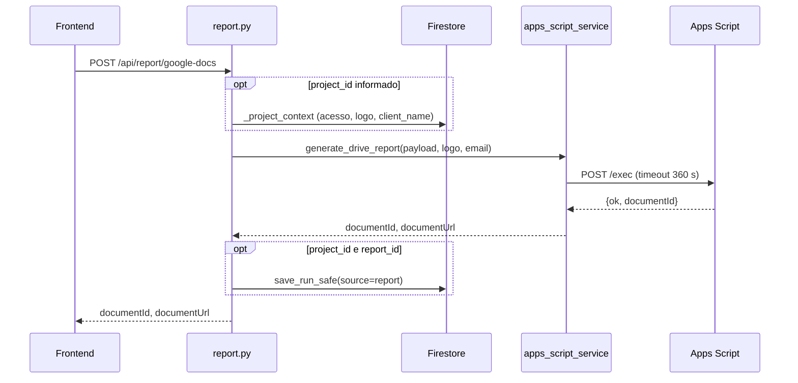

# Router Report

Prefijo `/api/report`, autenticado. Router: `backend/routers/report.py`. Servicios: `backend/services/apps_script_service.py` (`generate_drive_report`) y `backend/services/drive_service.py` (cuenta publicadora). Flujo completo en [Flujo de generación](../geracao-do-documento/fluxo-de-geracao.md) y [Apps Script](../integracoes/apps-script.md).

## Rutas

| Método | Ruta | Entrada | Respuesta | Errores |
|---|---|---|---|---|
| POST | `/api/report/google-docs` (`report.py:31`) | `{"payload": {...}, "project_id?", "report_id?"}` | `{"documentId","documentUrl"}` | 404, 422, 502, 503, 504 |
| GET | `/api/report/publisher-status` (`report.py:50`) | n/d | `{"configured": bool, "healthy": bool}` | n/d |

## Flujo de `google-docs`



1. Con `project_id`, `_project_context` (`report.py:21-28`) exige acceso (404 en caso contrario), toma el `logo_base64` del proyecto y, si el payload no tiene `client_name`, usa el del proyecto.
2. `generate_drive_report` (`apps_script_service.py:18`) valida la config, las colecciones y el logo, calcula mes/año a partir de `snapshot_date`, obtiene el token de la cuenta publicadora y hace `POST` al Web App con `{secret, payload, client_logo_base64}`.
3. Con `project_id` y `report_id`, guarda un run `report` con los ids del documento; `save_run` cambia el informe a `status: "generated"`.

## Errores de Apps Script

| Estado | Causa | Línea |
|---|---|---|
| 503 | Variables ausentes o URL que no es `/exec` | `apps_script_service.py:24,26` |
| 422 | Colección inválida o logo inválido (PNG/JPEG/GIF, hasta 5 MB) | `:31,45` |
| 502 | Falla al renovar el token, HTTP 4xx/5xx del Web App, falla de transporte, respuesta no JSON, `ok != true`, `documentId` inválido | `:58-88` |
| 504 | Timeout (360 s) | `:66` |

## Ejemplo

```bash
curl -X POST http://localhost:8000/api/report/google-docs \
  -H "Authorization: Bearer <id_token>" -H "Content-Type: application/json" \
  -d '{"payload":{"client_name":"Cliente Exemplo","snapshot_date":"2026-01-15T00:00:00Z"},
       "project_id":"<project_id>","report_id":"<report_id>"}'
# {"documentId":"<doc_id>","documentUrl":"https://docs.google.com/document/d/<doc_id>/edit"}
```

## Puntos de atención

- En 504 el documento **puede haberse creado**: revise la carpeta en Drive antes de generar de nuevo (mensaje del propio backend). Ver [Timeout y errores](../geracao-do-documento/timeout-e-erros.md).
- El payload enviado a Apps Script es el enriquecido (`document_owner_email`, `document_month`, `document_year`), pero el run guardado conserva el `payload` de la solicitud (con `client_name` completado, sin los campos del documento).
- `publisher-status` solo llama a `check_publisher_health` si `is_publisher_configured()`; refleja la cuenta publicadora, no la conexión de Google del usuario.
- Si `save_run_safe` falla, el documento ya existe y la respuesta sigue siendo 200.
