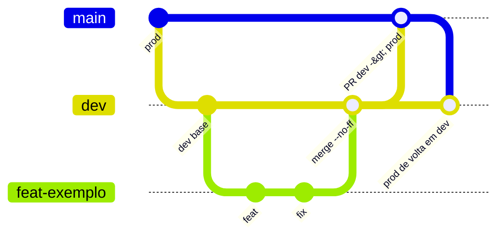

# Git y commits

Reglas provenientes de `AGENTS.md`, `CLAUDE.md` y del README de la app ("Fluxo Git para desenvolvimento solo", es decir, flujo Git para desarrollo en solitario), contrastadas con `git log`. Valen para trabajo **nuevo**; el historial existente se preserva.

## Modelo de branches

- `dev`: integración y base de toda tarea (branch predeterminada en GitHub, `origin/HEAD -> origin/dev`).
- `prod`: código aprobado para producción.
- Nunca desarrollar directamente en `dev` ni `prod`.
- Una branch de tarea a la vez: `feat/`, `fix/`, `hotfix/`, `refactor/`, `docs/` o `chore/` + descripción corta en inglés, minúscula, kebab-case. Sin prefijo de IA/herramienta. `chore/` también para pruebas o CI aislados. Sin branches de release.

(En el diagrama, `main` representa `prod`.)

## Paso a paso

1. Verificar branch y working tree; preservar cambios y stashes pendientes.
2. `git switch dev && git pull --ff-only`, luego crear la branch de tarea.
3. Para actualizar la branch de tarea, hacer **merge** de `dev` en ella.
4. Antes de integrar: revisar el diff y ejecutar pruebas de backend, pruebas de frontend y `npm run build` ([Pruebas](./testes.md)).
5. Integrar en `dev` localmente con `git merge --no-ff`.
6. Promover `dev` a `prod` mediante PR con "Create a merge commit". El dev en solitario revisa y concluye; no exige un segundo revisor. Después, merge de `prod` actualizado en `dev`.
7. Eliminar la branch de tarea solo tras confirmar la integración.

**Hotfix:** `hotfix/*` parte de `prod` actualizado, entra en `prod` por PR y vuelve a `dev` por merge de `prod`.

**Prohibido:** rebase, squash, force-push, reset para reescribir el historial. La divergencia se resuelve con merge. Pull solo con `--ff-only`.

**Branches heredadas** (`master`, `Database_integration`, `app-scripts-integration`, `new_template_and_application_changes`): no retomar ni combinar lo exclusivo de ellas sin revisión.

## Conventional Commits

Formato: `<type>(<scope opcional>): <descripción en imperativo, en inglés>`, incluso en merges hechos por humanos.

Conteo en 73 commits del historial actual (`git log` desde HEAD):

| Tipo | Cant. |
|---|---|
| `fix` | 26 |
| `feat` | 25 |
| `refactor` | 10 |
| `docs` | 2 |
| `chore` | 2 |
| `build` | 1 |
| fuera del patrón | 7 |

Scopes reales en uso: `appscript` (5, más las variantes `appscripts` y `apps-script`), `frontend` (5), `google-ads` (4), `deploy` (3), `report` (3), `transcripts`, `gtm-audit`, `ga4`, `crawler`, `auth`, `audit` (2 cada uno), además de `projects`, `persistence`, `observepoint`, `oauth`, `makefile`, `git`, `services`, `router`, `considerations`, `cleanup` y otros de uso único. No hay lista cerrada; prefiera un scope ya existente y escríbalo de forma consistente (`google-ads`, no `GAds`).

### Buenos ejemplos del historial

- `feat(projects): split client/project name and auto-record Google accounts`
- `fix(appscript): omit empty tables, forms list and considerations`
- `refactor(appscript): restructure EC and offline sections with subsections`

### Malos ejemplos (existen en el historial; no repetir)

| Commit | Problema |
|---|---|
| `Create CLAUDE.md`, `Create AGENTS.md` | sin tipo (mensaje predeterminado de GitHub) |
| `CI(prod): changes to ...` | tipo en mayúsculas e inexistente en el vocabulario |
| `BREAKING CHANGE: replace /api/report/docx ...` | sin tipo/scope; el pie `BREAKING CHANGE:` debería acompañar a un `feat!`/`refactor!` |
| `fix(appscripts) : adding the footer` | espacio antes de los dos puntos y verbo en gerundio |
| `fix(GAds): ...` | scope fuera del patrón kebab-case |
| `First Commit` | sin tipo |

## Práctica vs regla

- Solo hay **un** commit de merge real en el historial: `375c312 Merge branch 'feat/apps-script-reports' into dev ...` (y tampoco sigue el formato). La mayor parte del historial es lineal, anterior a la adopción del flujo.
- `prod` está detrás de `dev`: `dev` tiene 14 commits que `prod` no tiene y `prod` no tiene ningún commit exclusivo.
- Hay branches antiguas todavía presentes (`refator/documentation-and-ai-use`, con error de tipeo en el prefijo, además de las heredadas listadas arriba).
- 7 de 73 mensajes no siguen Conventional Commits.

## Pull requests

Explicar los cambios y la verificación, enlazar el issue cuando exista, adjuntar screenshots en cambios visibles de UI y destacar cambios en API, payload, plantilla o variables de entorno.

## Reglas para la IA

- La IA **no hace commit** (ni merge). Informa los archivos modificados, las verificaciones ejecutadas y **sugiere** un mensaje Conventional Commit.
- La IA nunca hace despliegue ni push a producción ([Despliegue](./deploy.md)).
- Inspeccionar branch y working tree antes de editar; no descartar ni mezclar cambios pendientes. Más en [AGENTS.md y CLAUDE.md](../ia-e-agentes/agents-md.md).
