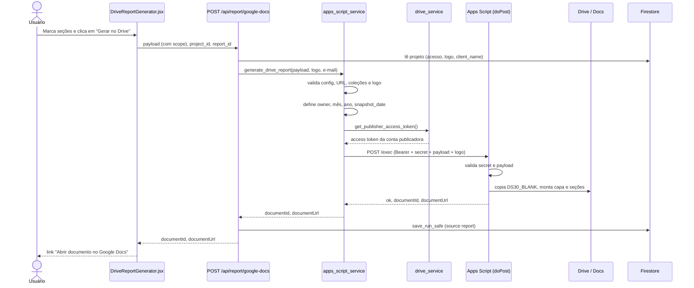

# Flujo de generación

El diagnóstico final es un Google Doc creado por un Web App de Apps Script. El backend FastAPI solo valida, complementa el payload y reenvía la llamada.

## Vista en secuencia



## Etapas

1. **Frontend.** `DriveReportGenerator` (`frontend/src/components/DriveReportGenerator.jsx`) muestra las decisiones pendientes y los checkboxes de sección (`SECTION_TOGGLES`). Cada checkbox llama a `withSectionToggle`, que escribe `payload.scope` (ver [Payload v3](./payload-v3.md)). El botón "Gerar no Drive" (Generar en Drive) llama a `generateDriveReport` en `frontend/src/services/api.js:121`, que envía `{payload, project_id, report_id}` con los encabezados de autenticación.
2. **Ruta.** `generate_google_doc` en `backend/routers/report.py:31` exige un usuario autenticado. Con `project_id`, carga el proyecto (404 si no existe o sin acceso, `backend/routers/report.py:21`), usa el `logo_base64` del proyecto y completa `client_name` si el payload no trae uno. El logo no viene de la solicitud.
3. **Servicio.** `generate_drive_report` (`backend/services/apps_script_service.py:18`) ejecuta las verificaciones siguientes.
4. **Apps Script.** `doPost` (`Docs/ds30_appscript/Main.js:70`) verifica el secreto y llama a `generateDs30`. Detalles en [Apps Script por dentro](./apps-script-por-dentro.md).
5. **Persistencia.** Si llegaron `project_id` y `report_id`, `save_run_safe` guarda la ejecución (`source='report'`) con el payload original, el correo y el documento (`backend/routers/report.py:42`). Es best-effort: una falla de Firestore no tumba la respuesta (`backend/services/firestore_service.py:116`).

## Orden de las verificaciones en el servicio

| # | Verificación | Línea | Falla |
|---|---|---|---|
| 1 | `DS30_APPS_SCRIPT_URL`, `DS30_APPS_SCRIPT_SECRET` y credenciales de la cuenta publicadora presentes | `apps_script_service.py:21` | 503 |
| 2 | La URL coincide con el patrón `https://script.google.com/.../exec` | `apps_script_service.py:25` | 503 |
| 3 | Las colecciones son listas de objetos (`gtm_containers`, `gtm_variables`, `gtm_tags`, `platform_accounts`, `conversion_actions`, `matching_signals`, `upd_form_urls`, `changelog_entries`, `analyzed_urls`, `cdns`) | `apps_script_service.py:27` | 422 |
| 4 | Logo: PNG/JPEG/GIF, hasta 5 MB, base64 válido, el formato real coincide con el MIME | `apps_script_service.py:32` | 422 |
| 5 | Campos definidos por el servidor: `document_owner_email` (de la sesión), `document_month` (en pt-BR), `document_year`, `snapshot_date` normalizado (usa la fecha actual si es inválido) | `apps_script_service.py:46` | n/a |
| 6 | Token de la cuenta publicadora (`get_publisher_access_token`) | `apps_script_service.py:55` | 502 |
| 7 | POST con `httpx`, timeout de 360 s (10 s de conexión), sigue redirecciones | `apps_script_service.py:59` | 502/504 |
| 8 | Respuesta JSON con `ok: true` y `documentId` válido | `apps_script_service.py:82` | 502 |

Las verificaciones 1 a 6 ocurren antes de cualquier llamada a Apps Script. Los códigos y qué hacer en cada uno están en [Timeout y errores](./timeout-e-erros.md).

## Respuesta

```json
{"documentId": "...", "documentUrl": "https://docs.google.com/document/d/<id>/edit"}
```

La URL la arma el backend a partir del `documentId`, no se reenvía desde el script (`apps_script_service.py:89`).

## Salud de la cuenta publicadora

`GET /api/report/publisher-status` (`backend/routers/report.py:50`) retorna `{configured, healthy}`: intenta renovar el token de la cuenta publicadora, sin tocar Apps Script.

Vea también: [Integración con Apps Script](../integracoes/apps-script.md), [API de informe](../api/report.md), [Variables de entorno](../referencia/variaveis-de-ambiente.md).
