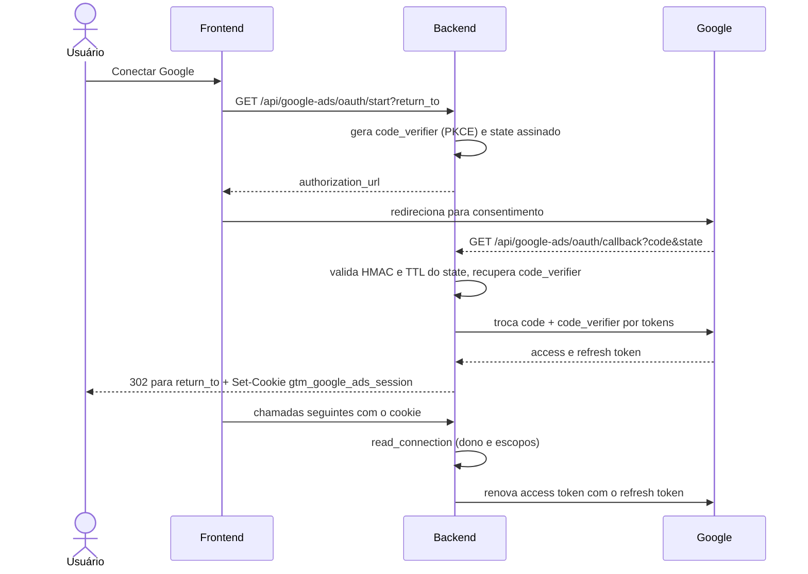

# Google OAuth (Ads, GTM y GA4)

Una única conexión por usuario atiende Google Ads, GTM y GA4. La implementación está en `backend/services/google_ads_oauth_service.py` y las rutas en `backend/routers/google_ads.py`. El nombre "Google Ads" quedó en el código por motivo histórico. Esta conexión es distinta de la cuenta publicadora que genera el documento (ver [Apps Script](./apps-script.md)).

## Scopes

| Scope | Uso |
|---|---|
| `https://www.googleapis.com/auth/adwords` | Google Ads |
| `https://www.googleapis.com/auth/tagmanager.readonly` | GTM |
| `https://www.googleapis.com/auth/analytics.readonly` | GA4 |

Constantes en `google_ads_oauth_service.py:20` a `:23`. El flujo pide `access_type=offline` y `prompt=consent` para obtener siempre refresh token (`:130`).

## Variables de entorno (solo nombres)

`GOOGLE_CLIENT_ID`, `GOOGLE_CLIENT_SECRET`, `GOOGLE_ADS_OAUTH_REDIRECT_URI`, `GOOGLE_ADS_SESSION_ENCRYPTION_KEY` para el OAuth (`:27`); Google Ads exige además `GOOGLE_ADS_DEVELOPER_TOKEN` (`:33`). `GET /api/google-ads/connection` informa `configured` y `missing_settings` (solo nombres). Ver [Variables de entorno](../referencia/variaveis-de-ambiente.md).

## Flujo

## Piezas de seguridad

- **PKCE.** `build_authorization_url` genera un `code_verifier` aleatorio (`:125`); viaja dentro del `state`, cifrado con Fernet (`:85`), y se recupera en `exchange_code` (`:141`).
- **State firmado.** `create_state` (`:78`) serializa `owner` (correo en minúsculas), `return_to`, `issued_at` y el verifier, firmando con HMAC-SHA256 usando `GOOGLE_ADS_SESSION_ENCRYPTION_KEY`. `read_state` (`:91`) compara la firma en tiempo constante y rechaza un state con más de `STATE_TTL_SECONDS = 600` s (o más de 30 s en el futuro).
- **`return_to`.** Solo se acepta si empieza con `/` y no con `//` (ruta relativa al propio sitio); de lo contrario cae en `/?google_ads=connected` (`:81`).
- **Cookie `gtm_google_ads_session`.** El refresh token **solo existe en esta cookie**: el contenido (`refresh_token`, `owner`, `scopes`, `issued_at`) se cifra con Fernet, cuya clave se deriva por SHA-256 de la clave de sesión (`:65`, `:167`). No hay copia en Firestore. Atributos: `httponly`, `samesite=lax`, `path=/api`, `secure` solo cuando `ENVIRONMENT` es `prod`/`production` (`backend/routers/google_ads.py:77`). El callback borra la cookie antigua con `path=/api/google-ads` para no sombrear la nueva.
- **`read_connection`** (`:176`) descifra la cookie y exige que `owner` sea el correo de la sesión autenticada y que los tres scopes estén presentes. Una cookie de otro usuario o una conexión antigua solo con Ads retorna error (la ruta lo convierte en 401, `backend/routers/google_ads.py:41`), pidiendo reconexión.
- **Revocación.** `DELETE /api/google-ads/connection` llama a `revoke_connection` (`:203`), que envía el refresh token al endpoint de revocación de Google (200 o 400 cuentan como revocado) y siempre elimina la cookie.

## Errores comunes del callback

El callback nunca devuelve JSON: redirige a `/?google_ads=error&message=...` (`backend/routers/google_ads.py:59`). Mensajes tratados: código expirado o reutilizado (`invalid_grant`), `redirect_uri_mismatch`, rechazo de Google, falla de red y ausencia de refresh token (revocar el acceso anterior y reconectar). La URI de redirección registrada en el cliente OAuth debe ser idéntica a `GOOGLE_ADS_OAUTH_REDIRECT_URI`; ver [Firebase y GCP](./firebase.md) para el paso a paso en la consola.

Relacionados: [Autenticación](../visao-geral-e-arquitetura/autenticacao.md), [API Google Ads](../api/google-ads.md), [API plataformas Google](../api/google-platforms.md).
