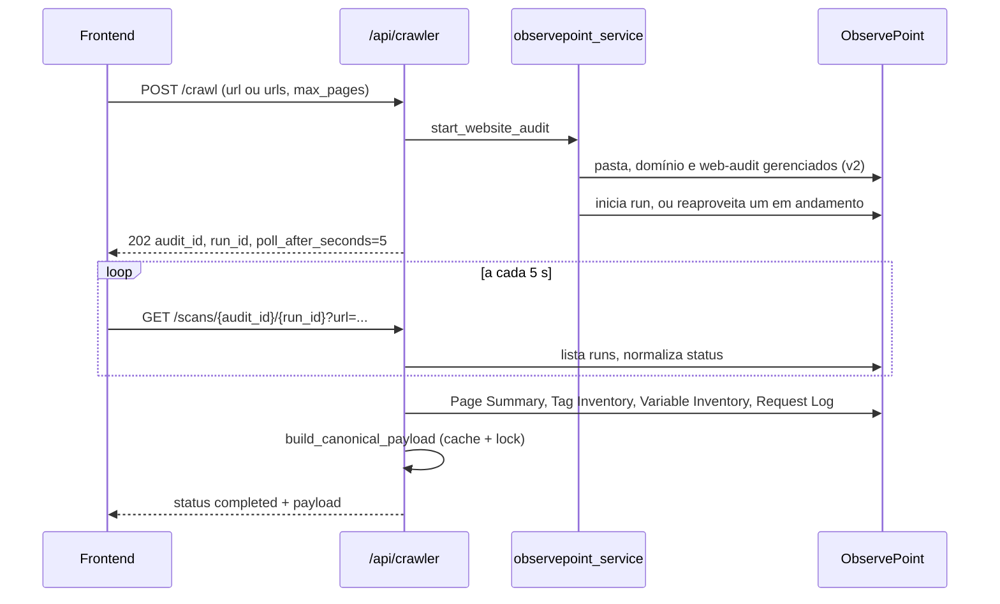

# ObservePoint

El crawler usa la API de ObservePoint para auditar páginas del cliente y transformar los informes del run en parte del [payload v3](../geracao-do-documento/payload-v3.md). Archivos: `backend/services/crawler_service.py` (entrada), `backend/services/observepoint_service.py` (API y payload), `backend/services/cdn_analyzer.py` y `backend/services/gtm_request_analyzer.py` (análisis). Rutas en `backend/routers/crawler.py` (ver [API crawler](../api/crawler.md)); todas exigen usuario autenticado (`backend/main.py:46`). Configuración: variables `OBSERVEPOINT_API_KEY` (encabezado `Authorization: api_key ...`, `observepoint_service.py:13`) y `OBSERVEPOINT_BASE_URL`.

## Flujo

## Inicio: `start_website_audit`

`crawler_service.py:33`:

1. Exige `OBSERVEPOINT_API_KEY`.
2. Normaliza las URLs (`normalize_url`, `:5`): HTTP/HTTPS obligatorio, sin credenciales, sin fragmento. Con lista exacta de URLs, el límite de páginas es la cantidad; con una URL, vale `max_pages` (predeterminado 10).
3. Consulta el límite de la cuenta (`get_account_page_limit`, `observepoint_service.py:152`) y rechaza si se excede.
4. `ensure_managed_audit` y `start_or_reuse_run`.

## Auditoría gestionada

`ensure_managed_audit` (`observepoint_service.py:166`) solo toca recursos de la propia app:

- Usa (o crea) la carpeta `GTM Analyzer App` (`MANAGED_FOLDER_NAME`), el dominio con el hostname dentro de ella y el primer web-audit de ese dominio. Si no existe, lo crea con `frequency: once`, filtro que incluye solo el hostname, Chrome/Linux, ubicación `brazil` y `fireTags: true`.
- Si las URLs iniciales o el límite cambiaron, actualiza el audit con `PUT` (que exige el objeto completo). Si ya hay un run en cola o ejecutándose **con otra configuración**, falla con un mensaje que pide esperar.

`start_or_reuse_run` (`:270`) devuelve el run en curso (`reused_running_run: true`) o crea uno nuevo.

## Polling y estado

`GET /scans/{audit_id}/{run_id}` (`backend/routers/crawler.py:101`) no guarda estado: busca el run y normaliza con `normalize_run_status` (`observepoint_service.py:260`):

| Estado normalizado | Cuándo |
|---|---|
| `completed` | `complete`, `completed`, `finished`, `success`, `succeeded`, o `completedAt`/`completed` presente |
| `failed` | `failed`, `failure`, `error`, `cancelled`, `canceled`, `aborted` |
| `running` | `running`, `in_progress`, `processing`, `started`, o `started` presente |
| `queued` | cualquier otro valor (predeterminado) |

En `completed`, la ruta arma el payload; con `project_id` y `report_id` guarda la ejecución (`source="crawler"`). En `failed`, devuelve `detail`.

## Payload canónico

`build_canonical_payload` (`:492`) con `_build_canonical_payload_uncached` (`:541`):

- **Caché y lock.** Con `run_id`, el resultado queda en `_payload_cache` (clave: tipo, id, run, URL objetivo), protegido por `asyncio.Lock`. Los polls concurrentes del mismo run comparten una única `asyncio.Task` (`_payload_tasks`); si la task falla, se elimina y la próxima llamada lo intenta de nuevo. La caché es por instancia y sin expiración, en memoria.
- **Informes leídos** (todos `v3`, timeout 20 s): Page Summary (páginas), Tag Inventory, Variable Inventory (con cuentas) y el Request Log por página (`fetch_page_requests`). Una falla en el request log de una página no tumba el payload: marca verificación fallida y el CDN puede salir `inconclusive`.
- **Campos completados:** `analyzed_urls` (con `url_type` inferido de `cart/carrinho`, `checkout`, `login`), `client_url`, `client_server` y `client_reverse_proxy` (encabezados `Server`/`Via`), `client_tag_manager` y `client_cookie_manager` (detección por nombre/ID), `platform_accounts` GA4 por regex (las cuentas de Google Ads se filtran), `upd_variables_identified` (variables con nombres como email/phone/user_data), `upd_form_urls` (páginas de checkout y login), `cdns`, `cdn_analysis_status`, `gtm_observations`, `gtg_implemented`, `server_side_gtm_used`, además de alias escalares y `derive_decision_fields` (`:906`).
- **No alimenta** `gtm_containers`, `gtm_variables` ni `gtm_tags`: esos datos quedan con las integraciones oficiales ([GTM y GA4](./google-tag-manager-e-ga4.md)), ver `Docs/observepoint_field_overlap.md`.

## `cdn_analyzer.py`

`analyze_cdns` agrupa evidencias por proveedor, con el nombre de la página de origen:

| Método | Evidencia |
|---|---|
| `http_headers` | Encabezados de la página (`detect_cdn_from_headers`, por ejemplo `cf-ray`, `x-amz-cf-id`, `x-akamai-transformed`) |
| `dns_cname` | Cadena CNAME (hasta 5 saltos, timeout 3 s) del host de la página y de hosts first-party del request log, cotejada con sufijos conocidos |
| `ip_asn` | ASN de la IP del servidor (consulta DNS a Team Cymru), para Azion, Cloudflare, Akamai y Fastly |

Confianza: `confirmed` (hay encabezado), `infrastructure_detected` (ASN) y `dns_only`. Estado general: la menor confianza entre los CDNs, `no_cdn` si no se encontró nada e `inconclusive` si hubo error de verificación. La resolución de DNS corre con un máximo de 5 hosts en paralelo.

## `gtm_request_analyzer.py`

`analyze_gtm_requests` examina las URLs del request log: `gtm.js` con `GTM-` indica container (web si el host es `googletagmanager.com`, server en caso contrario, con endpoint); `gtag/js` con `G-`/`AW-`/`GT-` indica Google tag, y un host fuera de Google indica Tag Gateway (`gtg_implemented`). Devuelve `gtm_observations` con `deployment` (`web`, `server`, `client-side`, `gateway`). Sin requests, `gtg_implemented` y `server_side_gtm_used` quedan en `None`.

## Sobre los documentos de apoyo

- `Docs/doc_observepoint.md` es una copia de la referencia de la API v2 de ObservePoint (campos de carpetas, dominios, audits), no describe el código de la app.
- `Docs/observepoint_field_overlap.md` describe la decisión de no dejar que ObservePoint sobrescriba GTM y Ads. Verificado: el código actual coincide (`observepoint_service.py:857` en adelante). La parte de GA4 sigue viniendo de ObservePoint, como admite el propio documento.

Pruebas: `backend/tests/test_observepoint_service.py`, `test_crawler_service.py`, `test_cdn_analyzer.py`, `test_gtm_request_analyzer.py`.
