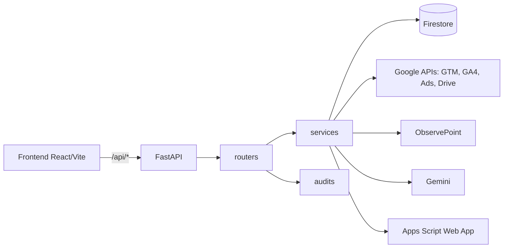
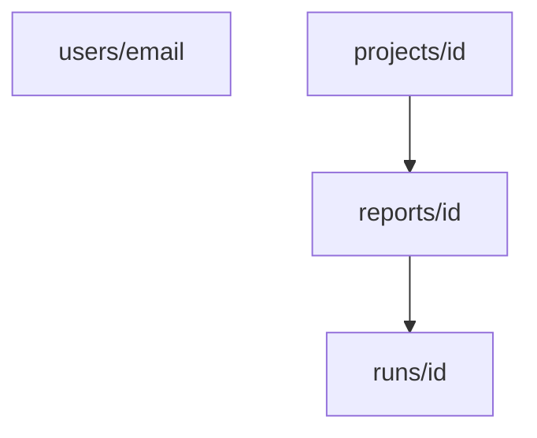

# Arquitectura

## Componentes

- Todos los routers, excepto `auth` y el callback OAuth de Google Ads, se montan con `Depends(get_current_user)` (`backend/main.py:39-49`).
- CORS usa `ALLOWED_ORIGINS` (`backend/main.py:31`).
- `GET /health` y `GET /api/health` responden `{"status": "ok"}` (`backend/main.py:51-54`).
- En desarrollo, Vite (puerto 5173) hace proxy de `/api` hacia `localhost:8000` (`frontend/vite.config.js`).

## SPA servida por el backend

El `Dockerfile` tiene dos etapas: `node:20-alpine` ejecuta `npm run build` y `python:3.11-slim` copia el resultado a `backend/static`. Si `backend/static` existe, `main.py` monta `/assets` y una ruta catch-all devuelve el archivo solicitado o `index.html` (`backend/main.py:57-68`). Sin la carpeta, `/` devuelve solo un JSON de estado. La imagen también copia la plantilla `.docx` y el mapeo de variables de `Docs/`. El proceso escucha en `$PORT` (valor predeterminado 8080).

## Modelo en Firestore

Base de datos `gtm-analyzer`, accedida solo por el backend con credenciales predeterminadas (ADC). Detalles campo por campo en el [Diccionario de datos](../referencia/dicionario-de-dados.md).

- `users/{email}`: espejo del perfil de inicio de sesión.
- `projects/{id}`: colección de nivel superior (proyectos compartibles); `owner_email` y `member_emails` controlan el acceso.
- `projects/{id}/reports/{id}` y `.../runs/{id}`: informes e historial inmutable de ejecuciones.

## Flujo de una acción típica: generar el diagnóstico

1. El frontend llama a `POST /api/report/google-docs` con `payload`, `project_id` y `report_id`; `api.js` agrega los encabezados de autenticación.
2. `get_current_user` valida al usuario (ver [Autenticación](./autenticacao.md)).
3. El router verifica el acceso al proyecto (404 si no lo tiene), lee el logo y completa `client_name` (`backend/routers/report.py:31-45`).
4. `generate_drive_report` valida `DS30_APPS_SCRIPT_URL` y el secreto, y llama a Apps Script (timeout de 360 s) (`backend/services/apps_script_service.py`).
5. `save_run_safe` guarda un `run` con `source="report"` y marca el informe como `generated`.
6. La respuesta devuelve `documentId` y `documentUrl`.

Detalles en [Flujo de generación](../geracao-do-documento/fluxo-de-geracao.md).

## Cachés y estados por instancia

Algunos estados viven en la memoria del proceso y **no se comparten** entre instancias de Cloud Run ni sobreviven a un reinicio:

- OTP, sesiones de correo y rate limit (`backend/services/auth_service.py:16-27`).
- Caché de cuentas de Google Ads, TTL de 300 s (`backend/services/google_ads_api_service.py:57-73`).
- Caché de payload canónico de ObservePoint (`backend/services/observepoint_service.py:33`).

Con más de una instancia, un inicio de sesión por OTP puede fallar si la verificación cae en otra instancia. Persistir en Firestore es la evolución natural, si hace falta.
